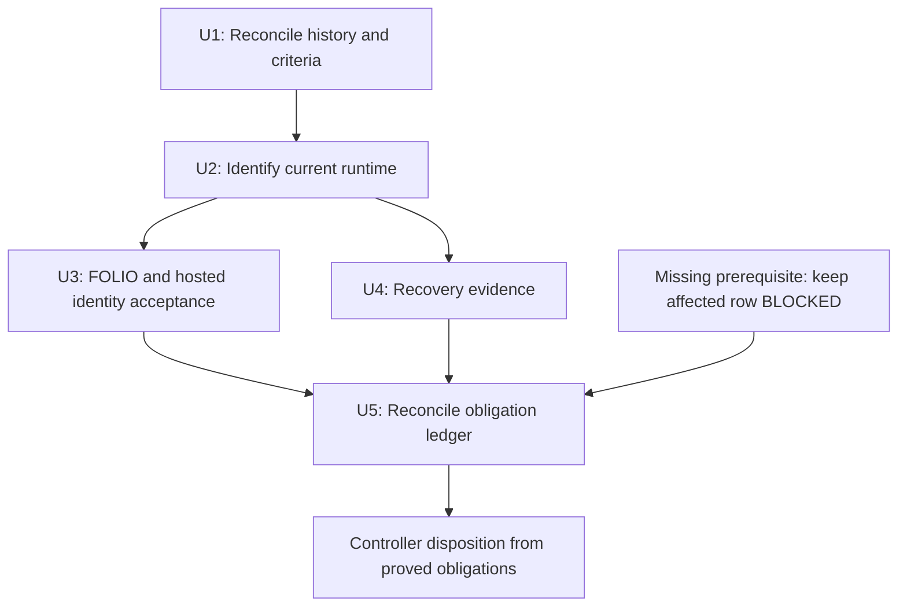

# Reconcile U9 deployment and acceptance evidence - Plan

## Goal Capsule

- **Objective:** Operators can establish whether the current DEV release satisfies U9 deployment, FOLIO acceptance, hosted identity, and recovery obligations before the BAIF Rome demo on 2026-11-05/06.
- **Means:** Reconcile existing receipts, obtain only missing acceptance evidence, and publish an obligation ledger using KTD1–KTD4.
- **Authority:** The controller's `oa-2` mandate and campaign rules govern this item; repository `AGENTS.md` governs local work. The chief repository's `docs/plans/2026-10-26-0705-feat-codex-drawdown-campaign-plan.md` Goal Capsule and Campaign R11, R15–R20 must be supplied before final acceptance reconciliation (G1).
- **Execution boundary:** This handoff is plan-only. Later repository work is documentation and sanitized evidence on `drawdown/oa-2`; the controller supplies authorized live observations, publishes to `dev`, and routes merging through the campaign gate.
- **Stop conditions:** Missing evidence keeps the affected obligation open. Stop a dependent operation on missing preservation, authority, or access prerequisites; continue independent documentation work under R7–R8.

This plan is not a DEV deployment or acceptance receipt.
Lineage: “OntoKit DEV: first dev-line deploy (U9) — waiting on the dev-deploy approval click,” sweep `weekly-sweep-20260928t120410-095f52`.

---

## Product Contract

### Summary

Create `docs/releases/oa-2-u9-acceptance.md` with one evidence-backed disposition for each U9 obligation.
Collect dated, sanitized supporting receipts under `docs/plans/evidence/oa-2/` and correct only the U9-related assertions in `deploy/RUNBOOK.md`.
Prepare the controller's card and issue disposition without sending messages or closing issues from this lane.

### Problem Frame

The original approval-wait premise predates the EU move and subsequent deployment fixes.
Repository history establishes available code and historical claims, but cannot establish what runs now, whether login works, or whether current data can be recovered.
An accurate ledger may still contain open gates; that is distinct from satisfying U9.

**Product Contract preservation:** The original preservation, missing-acceptance-only, separate-identity, and recovery requirements are unchanged. The rules below make their evidence and ownership boundaries explicit.

### Requirements

**Deployment and runtime**

- R1. Reconcile run `34155698435`, issue `#43`, later DEV deployments, and their immutable manifest revisions without replaying a successful deployment to obtain a new receipt.
- R2. Match the accepted deployment pair to the observed API, worker, and web image identities and source revisions, with current service health and evidence of the runtime-file permissions repair.

**User acceptance and recovery**

- R3. Prove FOLIO import/re-import against the companion runbook's original acceptance criteria, recording source revision, expected and observed counts, failures, and user-visible results.
- R4. Record dated hosted-identity UAT separately from deployment and import success, using the accepted web release's documented login and authenticated-user expectations.
- R5. Prove recovery through an eligible accepted-prior-pair exercise or an independent restore on an isolated target, including restored data and functioning services.

**Evidence and operating boundaries**

- R6. Every required obligation has dated eligible evidence or a specific remaining gate; U9 acceptance requires every obligation to pass, while issue `#43` is judged against its own verified scope.
- R7. Keep all receipts public-safe and all work within the campaign's lane restrictions: no credential discovery or forbidden-file reads, security-setting changes, spend, sends in Damien's voice, force-push, or deletion without a verified backup. No new migration, data rewrite, package release, or outside service is authorized by `oa-2`.
- R8. Complete all independent preparation while the controller obtains missing authority, access, companion criteria, and preservation evidence. Do not add a remote or seek a login in this clone; report only a demonstrated person-only requirement as a decision for Damien.

### Key Decisions

- **Continue independent work while evidence is unavailable.** Governs R8 (session-settled: user-directed — chosen over waiting for Damien: he has zero time through 2026-10-30).
- **Keep this branch on the assigned planned item.** Governs R7–R8. The campaign's settled expansion policy, Astra model choice, and hygiene-after-worthwhile-work policy remain in force; none adds scope to `oa-2`.

### Scope Boundaries

No application, frontend, manifest, workflow, deploy-script, or host-configuration changes are planned.
Image-deploy activation and GHCR visibility changes are not prerequisites for accepting the existing source-built release.
AWS provisioning, PROD promotion, database resets, and infrastructure moves are outside this item.

A new receipt validator or expanded `status` command was considered and is not planned: existing controller-side collection can supply the missing fields without adding another interface.
Reconsider only if authorized collection demonstrably cannot produce required evidence; route any resulting scope change through the controller.

### Deferred to Follow-Up Work

`oa-1` owns landing the October 20 changes, `oa-3` owns mypy drift, `oa-4` owns API defects from the web rehearsal, and `oa-5`/`oa-6` own their separate expansion and hygiene work.
Record defects discovered during acceptance for the controller without implementing those items here.

---

## Planning Contract

### Reverified Starting State

Static inspection on 2026-10-26 found a clean `drawdown/oa-2` at `83af4be6cdd9f3027e3319eadbd1c1ccfb54c55a`.
The local `dev` ref is `62469e0c4cb2d0d322b6fcaec9c1acbdd5e6ae15`, five commits behind this branch; it is not a fresh upstream baseline.
There are no remotes or `origin/*` refs. No tests, application commands, or live checks were run during planning.

| Source | Verified local fact | Limit |
|---|---|---|
| `deploy/release-manifest.json` | Schema 1; API `455f706c000d87d3d87d7939cfeab470fe78cd2b`, web `4cbe4d4c17437660b70764acb364d24b20ef20ba` | Declared pair only; not asserted live or accepted |
| `455f706c000d87d3d87d7939cfeab470fe78cd2b` and `6464f74c68fa942c96e5aa411b250254102c11e4` | Historical permissions repair and corrected U9 manifest, associated with #44/#45 | Current runtime permissions and issue #43 disposition remain unverified |
| `dcbce302350cc0044aa624ffd2dad76915d93399` | Available historical candidate manifest names API `13ad2f35d55196274c5fec313bfb254a7cc80226` and web `83eaf9574315b71a165b80370dd964572d2ccac9` | Different from the current manifest; neither pair may be selected by assumption |
| `b14d30f1` (#63) | Lock-drift implementation, plan, and tests are present | Requested `docs/handoffs/2026-10-05-lock-drift-guard-pr63.md` is absent, including available path history |
| `49ff0bea`, `38fc1307`, `83af4be6` (#69–#71) | OSV fixes, image-deploy contract, and AWS readiness changes are in this branch's ancestry | The three named October 20 `origin/*` branches are unavailable; merged contents were inspected instead |
| `docs/handoffs/2026-10-20-sweep-cloud-ontokit-api.md` | Records historical local/CI results and explicitly says no deploy or host change occurred | Its test counts and restore rehearsal are not fresh DEV acceptance |
| `deploy/RUNBOOK.md` | Records EU move on 2026-09-21, separate hosted-identity acceptance, and recovery limitations | Workflow-enabled state and required-reviewer policy need current controller evidence |

The chief campaign plan and `ops/drawdown/mandates/_common.md` were not available in the supplied sandbox.
Campaign R-ID references here identify the controller-supplied standing rules, not a claim that their full source text was inspected.

### Key Technical Decisions

- KTD1. **Reconcile before exercising DEV.** Use immutable run/commit receipts and current observations to identify the accepted pair (R1–R2). Preserve a healthy existing release; neither the branch head nor the tracked manifest is a deployment target by default.
- KTD2. **Bind evidence to its release and observation window.** Each receipt names its obligation, UTC observation time, environment, procedure, expected/actual result, collector role, source link or artifact, and outcome (R6). Runtime receipts record each service's image ID, OCI revision, and registry digest when available; other receipts reference that runtime observation. A source-built image may have no registry digest: record that absence alongside its actual immutable image ID. Bracket acceptance with runtime observations and invalidate affected current-release conclusions when intervening deployment or data changes make them stale.
- KTD3. **Keep evidence collection narrow.** The controller uses existing authorized operator access and returns only allowlisted fields (R2, R7–R8). `status` obtains image revision labels through container image IDs, reports checkout drift and nine service states, and fails on missing/unhealthy/drifting services; it does not print image IDs or registry digests. Supplement it with formatted identity/metadata observations, never full Docker inspection, environment dumps, tokens, backup contents, or raw private responses. The `status` entrypoint also takes a lock and writes an audit outcome; it does not source the deployment environment.
- KTD4. **Reuse valid recovery proof; otherwise use isolated restore.** R5 does not require disturbing successful DEV. Before any acceptance write, require a verified backup covering the affected stores and a documented safe terminal state (R7). Before restore, require a fresh isolated destination on already authorized infrastructure. A previous-pair record, backup checksum, or script completion line is not recovery proof; missing preservation or isolation blocks only the dependent operation.

### Evidence Outcomes

Use `PASS` only when an eligible receipt proves the stated criterion; `FAIL` when an observation contradicts it; `NOT RUN` when it has not been performed and no specific blocker is established; and `BLOCKED` when a named missing prerequisite prevents verification.
Retain historical receipts as historical even if a newer observation fails.
Each non-PASS row names its owner, missing proof, and next authorized action.

### Evidence Flow

### Assumptions and Controller Dependencies

These are execution prerequisites, not requests to interrupt Damien. Documentation preparation can proceed while they are missing.

| Gate | Needed input and owner | What it unblocks |
|---|---|---|
| G1 | Controller supplies only the chief campaign Goal Capsule and cited R11/R15–R20, plus the missing October 5 handoff or an explicit unavailable-source disposition | Authority/requirement reconciliation before final acceptance disposition |
| G2 | Controller supplies current upstream `dev`, original and later deploy-run/job receipts, and issue #43 scope/state | U1 deployment and issue conclusions |
| G3 | Authorized operator supplies sanitized current DEV status, immutable identities, permission metadata, and installed-script/Compose version attestations | U2 and release binding for U3/U4 |
| G4 | Web lane supplies `docs/roundup-2026-08/DEV-RUNBOOK.md` from the accepted web revision, original FOLIO criteria/input identity, and dated UAT receipts | U3's exact acceptance oracle; no invented counts or roles |
| G5 | Controller supplies preservation proof and, if needed, an already authorized isolated recovery target and eligible test session | Missing acceptance writes and U4 execution |

If a gate actually requires Damien, the final handoff records what is needed, one of the campaign's settings, estimated minutes, and the obligation it unblocks.
A current personally restricted deployment approval must identify the exact run and environment action; a historical run alone does not establish that requirement.

---

## Implementation Units

### U1. Reconcile deployment history and issue scope

**Goal:** Identify the successful deployment evidence and the residual permissions obligation.
**Requirements:** R1, R6, R8. **Dependencies:** G1/G2 for final conclusions; local preparation is independent.
**Files:** Create `docs/releases/oa-2-u9-acceptance.md` and dated sanitized receipts under `docs/plans/evidence/oa-2/`.

**Approach:** Start from the local facts above. Have the controller obtain run `34155698435`, later Deploy DEV runs, and issue #43 using read-only access; record run URL/ID, attempt, date, head SHA, deploy-job result, and manifest pair at that immutable revision. Reconcile CI evidence for that release separately from host observation. Follow KTD1 rather than dispatching a deployment.

**Patterns:** `.github/workflows/deploy-dev.yml`, `deploy/release-manifest.json`, and the October 20 handoff.
The workflow's preflight can succeed while the deploy job is skipped, so an overall green conclusion is insufficient.

**Test expectation:** No new automated test; this unit records evidence without changing behavior.
**Verification scenarios:** An executed successful deploy is distinguishable from a skipped job; later successful evidence can supersede the stale approval premise; an issue's closed state does not itself establish complete U9 acceptance.
**Done:** The ledger explains each historical outcome and identifies the supported pair or the precise G2 gap, with no deployment replay.

### U2. Bind current DEV runtime to the accepted pair

**Goal:** Establish what is running and whether the permissions repair and services are healthy.
**Requirements:** R2, R6–R8. **Dependencies:** U1's candidate/evidence mapping and G3.
**Files:** Extend the U1 ledger and evidence directory; no deploy-script change.

**Approach:** Apply KTD2–KTD3. Capture restricted `status`, its exit classification, and per-container immutable image identity. Compare API and worker revisions to the accepted API SHA and web to the accepted web SHA; investigate any unexpected API/worker image difference. Record service states and restart counts before and after the acceptance window. Separately obtain non-root runtime access checks for the files implicated in #43, using ownership/mode/access results without file contents. Record whether installed deploy-script and Compose copies match their intended repository revisions.

**Patterns:** `deploy/ontokit-deploy.sh` (`show_status`, `running_image_revision`, `compose_status`), `deploy/compose.dev.yaml`, `Dockerfile`, and `deploy/RUNBOOK.md`.
The worker healthcheck only recognizes `arq` in PID 1's command line; it is not proof of job completion.

**Test expectation:** No new automated test; collect operational observations.
**Verification scenarios:** A missing worker, ambiguous container, missing label, unhealthy service, or revision mismatch prevents PASS. A source-built image without a registry digest can satisfy identity using its actual image ID and revision. A status failure is distinguished from SSH transport/authentication failure, without changing credentials.
**Done:** Each service is linked to the accepted release and its health evidence, with an explicit verdict on #43's runtime-file criterion or a named gap.

### U3. Reconcile FOLIO and hosted-identity acceptance

**Goal:** Prove the original user-facing obligations on the identified DEV release.
**Requirements:** R3–R4, R6–R8. **Dependencies:** U1, U2, G4; G5 before any new acceptance write.
**Files:** Extend the U1 ledger and evidence directory. The web companion runbook is a controller-provided source, not an edit in this branch.

**Approach:** Extract the companion criteria at the accepted web revision before judging results. Reuse eligible dated receipts, then have the authorized operator run only missing steps. For FOLIO, bind the dataset revision/checksum, expected and observed import/re-import counts/deltas, failures, and visible browse/search result to the release. For hosted identity, record sign-in/callback, expected authenticated behavior for the documented test role, and sign-out/session termination. Keep the two outcomes separate. Retain only public-safe screenshots and structured results; no browser state, cookies, account details, or private ontology text.

**Patterns:** Companion `docs/roundup-2026-08/DEV-RUNBOOK.md`; API `deploy/RUNBOOK.md` authentication section.
`deploy/smoke-release.sh` is supplementary: it imports synthetic Turtle, mints/saves/submits, and deletes the project. Its literal `revision_contract=immutable` output proves neither runtime identity, FOLIO acceptance, nor browser login. Do not run its write/delete flow without R7/KTD4 prerequisites.

**Test expectation:** No new test code; actual acceptance scenarios and any existing tests remain intact.
**Verification scenarios:** Exact companion counts and expected re-import behavior agree with observations; unresolved import failures remain FAIL. Healthy API with failed hosted login leaves R4 open. Missing companion criteria is BLOCKED, not a guessed PASS. An intervening release change requires reassessing affected receipts under KTD2.
**Done:** FOLIO and identity each have an independently reviewable outcome and eligible evidence, or a precise remaining gate.

### U4. Establish actual recovery evidence

**Goal:** Demonstrate that the accepted service/data state can be recovered.
**Requirements:** R5–R8. **Dependencies:** U1, U2, G5; G4 for restored user acceptance checks.
**Files:** Extend the U1 ledger and evidence directory; reference `deploy/MIGRATION.md` without authorizing a host migration.

**Approach:** Follow KTD4, preferring existing eligible recovery receipts. If a rehearsal is missing, the controller restores into a verified fresh isolated target and records backup identity, checksum/readability verification, capture mode/consistency, source release/schema, and destination isolation. Compare expected and restored application data, git repository state, object storage, identity data, and relevant queue state. Start the intended service pair and verify health plus the applicable FOLIO/login acceptance. Record the terminal state and confirm successful DEV was preserved. A failed rehearsal remains isolated for diagnosis; cleanup follows R7.

**Patterns:** `deploy/backup-dev.sh`, `deploy/restore-dev.sh`, `deploy/MIGRATION.md`, and `deploy/tests/backup-restore-test.sh`.
Backup artifacts contain credentials and private data and remain outside this lane. Live backup mode permits cross-store inconsistency; writer-pausing capture requires a documented service-preservation window. The restore script suppresses SQL import errors and its schema-revision check alone cannot establish complete recovery. Require the data/service checks above rather than relying on its exit message.

**Test expectation:** No new automated test for documentation. The existing Docker round-trip test is synthetic supporting evidence, not a restore of current DEV; `SKIP docker unavailable` counts as NOT RUN even with exit zero.
**Verification scenarios:** Checksummed backup with no restore leaves R5 open; matching schema with missing application rows/files fails; a saved previous pair without exercised recovery is insufficient; unavailable safe target is BLOCKED. An eligible completed restore includes both restored-state checks and working service/user checks.
**Done:** R5 has a concrete eligible recovery receipt or a named preservation/access failure. No successful DEV release is disturbed merely to make evidence.

### U5. Publish the reconciled account and residual disposition

**Goal:** Give the controller an accurate U9 decision and operational documentation.
**Requirements:** R1–R8. **Dependencies:** Reconcile every U1–U4 outcome, including open gates.
**Files:** Finalize `docs/releases/oa-2-u9-acceptance.md`; update only relevant U9 passages in `deploy/RUNBOOK.md`; retain dated sanitized receipts under `docs/plans/evidence/oa-2/`.

**Approach:** Attribute old runbook assertions to their dates and replace current-tense claims only when a new receipt supports them. Link every ledger row to evidence or a gate with its owner and next action. Include a controller-ready draft card titled “Reconcile U9 deployment, acceptance, and rollback evidence against the current EU release,” and a separate issue #43 disposition grounded in its verified scope. Apply R8 to any demonstrated person-only blocker. Leave external publication/disposition to the controller and campaign gate.

**Patterns:** `docs/handoffs/2026-10-20-sweep-cloud-ontokit-api.md` separates receipts, missing host work, and work not done.
**Test expectation:** No new automated test; review source attribution, links, coverage, and public-safe contents.
**Verification scenarios:** An all-blocked ledger remains visibly unaccepted; issue #43 can be resolved only for its own proved obligation; omitted, failed, stale, and skipped evidence cannot become a completion claim.
**Done:** Documentation describes actual residual work and separates documentation completion from U9 acceptance.

---

## Verification Contract

Planning uses static source/history inspection only; the commands and acceptance exercises below belong to the later build/verification stage.

| Check | Evidence and limit |
|---|---|
| Manifest contract | `python3 deploy/validate_release_manifest.py deploy/release-manifest.json` validates syntax only; preserve the manifest bytes |
| Existing manifest tests | `pytest tests/unit/test_release_manifest.py` checks schema 1/2 and malformed/mixed-image rejection; passing is not runtime proof |
| Deployment implementation coverage | `deploy/tests/ontokit-deploy-test.sh` covers drift, matching runtime, failed retries, and recorded rollback modes with mocks; rerun only if relevant implementation changes are separately authorized |
| Synthetic recovery coverage | `deploy/tests/backup-restore-test.sh` belongs in an authorized disposable environment; require actual non-skip execution and preserve its synthetic-data limitation |
| Operational acceptance | U1–U4 scenarios must use eligible, release-bound controller receipts; mocks and source inspection cannot substitute |
| Documentation diff | Verify every required obligation, source/receipt link, outcome, and gate owner; check whitespace and public-safe content; preserve all existing tests |

No frontend change is planned, so this branch needs no changed-page screenshot.
If acceptance screenshots are supplied, store only sanitized images under `docs/plans/evidence/oa-2/` and link them from their dated receipt.

---

## Rollback and Release

The repository change is documentation-only and can be reverted without a runtime rollback.
No release-manifest change, deployment dispatch, host refresh, image-deploy activation, or package publication is part of this plan.
Any later live acceptance action must satisfy KTD4 and record its safe terminal state before it starts.
Do not backdate receipts or promote historical local verification to current DEV proof.

---

## Definition of Done

**Reconciliation delivered:** U1–U5 produce a reviewed, public-safe ledger and scoped runbook update, with all obligations covered by evidence or an explicit gate. The branch contains only the assigned item's documentation/evidence, with no abandoned implementation artifacts or unrelated changes. Missing authority sources remain visible until G1 is resolved.

**U9 acceptance satisfied:** G1 is resolved and every mandatory deployment/CI, runtime/permissions/health, FOLIO, hosted-identity, and recovery obligation is PASS under R1–R6. No missing, failed, blocked, skipped, or stale observation is counted as success. The controller alone applies the external card/issue disposition and campaign merge process.

A completed plan or a merged documentation PR does not by itself satisfy U9 acceptance.
