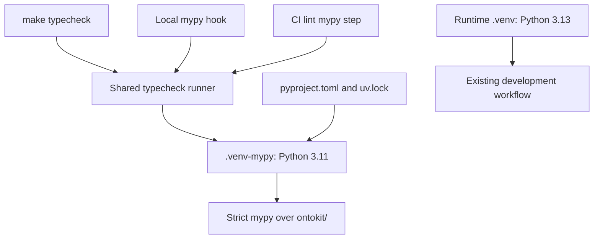

# Align local and CI mypy environments - Plan

## Goal Capsule

- **Objective:** Contributors can trust local mypy results to match the required Python 3.11 check in CI.
- **Means:** One shared checker entry point backed by a reusable, locked Python 3.11 environment (KTD1).
- **Authority:** The supplied `oa-3` mandate and standing drawdown rules govern this item. The chief-repo authority is `docs/plans/2026-10-26-0705-feat-codex-drawdown-campaign-plan.md`, specifically its Goal Capsule and campaign R11, R15-R20; source availability is recorded below.
- **Delivery:** This stage commits this plan only on `drawdown/oa-3`. The later build stage implements and verifies it locally. The controller handles scanning, publication and the PR targeting `dev`; the campaign gate handles merging.
- **Limits:** No remote or credential discovery, spend, security-setting changes, external messages, force-push, or deletion without a verified backup. No migration, data rewrite, package release, deployment or new outside service is needed.

---

## Product Contract

### Summary

Make local type checking use the same interpreter and locked dependencies as CI's required lint job.
Preserve Python 3.13 runtime development and the existing strict Python 3.11 typing policy.

### Problem Frame

The local pre-commit hook and `make typecheck` use the default uv project environment, whose tracked interpreter pin is Python 3.13.
CI's lint job selects Python 3.11 explicitly.
The lockfile resolves different NumPy versions for those interpreters, and repository history records newer NumPy stub syntax aborting the 3.11-targeted checker.
This makes a local failure an unreliable signal about application type correctness and slows demo preparation.

The current checkout has no `.venv`.
Static inspection establishes the configuration mismatch and historical failure mechanism; it does not establish a fresh failing or passing mypy result.

### Requirements

**Checker parity**

- R1. `make typecheck`, the mypy pre-commit hook and CI's lint check run the same full `ontokit/` check under Python 3.11.
- R2. Checker dependencies come from the existing project manifest and lockfile, including the dev group; retain strict mode, the Python 3.11 target and `pydantic.mypy` without adding suppressions.
- R3. Dependency synchronization or checker failures remain visible and return failure to the caller; the checker must not rewrite `uv.lock` or silently fall back to another environment.

**Preservation and proof**

- R4. Local checking leaves the runtime `.venv` intact and preserves `.python-version`, the public Python compatibility range, runtime dependency declarations, Docker Python versions and other CI jobs' interpreter selection.
- R5. Add regression coverage for the new invocation contract, preserve every existing test, and collect real environment and entry-point evidence during implementation.
- R6. Keep implementation confined to typing-tool setup, invocation, documentation and verification for `oa-3`; application/API behavior remains outside this item.

### Scope Boundaries

Include the minimum setup correction necessary for the documented contributor flow: `dev` is a dependency group, while `make setup` currently requests an extra.
Do not expand that correction into a Makefile cleanup.

Considered and not built: a global NumPy cap, a higher mypy target, a checker upgrade, or changed import handling would alter the checked dependency contract or conceal the mismatch.
Reconsider dependency changes only if a fresh locked 3.11 reproduction disproves this diagnosis.
A custom environment manager, retry system and new checker configuration are unnecessary because uv already owns synchronization and failure reporting.

The other mandate items, U9 acceptance, AWS readiness, deployment changes and broader dependency auditing remain separate work.
There is no frontend change, so screenshot evidence does not apply.

---

## Planning Contract

### Re-verified Starting State

Observed on 2026-10-26 using source and Git metadata only; no tests, checker, installs or runtime probes were executed.

| Surface | Evidence | Consequence |
|---|---|---|
| Branch | Clean `drawdown/oa-3` at `83af4be6`; local `dev` at `62469e0c`, five commits behind this branch | Do not reset to the older local base or claim live remote parity |
| October 20 work | History contains `49ff0bea`, `38fc1307` and `83af4be6` for the dependency, image-contract and readiness changes | Preserve these existing changes; do not redo `oa-1` |
| Runtime selection | `.python-version` is `3.13`; both Dockerfiles use Python 3.13 | A root-pin change would affect work beyond mypy |
| Typing policy | `pyproject.toml` targets 3.11 for mypy and pyright; mypy is strict with `pydantic.mypy` | Preserve the authoritative policy |
| Locked resolution | `uv.lock` contains mypy 2.3.1, NumPy 2.4.6 below Python 3.12 and NumPy 2.5.2 on Python 3.12+ | Interpreter selection changes the installed stub branch |
| Current callers | `.pre-commit-config.yaml` and `Makefile` use `uv run mypy ontokit/`; CI lint explicitly sets up 3.11 | Align the callers' environment as well as their command |
| Setup and exclusions | `make setup` uses `--extra dev`; `.gitignore` does not cover `.venv-mypy/`, and `.dockerignore` does not exclude it | Correct the group selector and exclude the new environment |
| Installed state | No `.venv` is present | Installed versions and present-day failure reproduction remain build-stage evidence |

Commit `095b351c` introduced the 3.13 pin to align default CI selection with the runtime images.
Commit `76410c97` records the NumPy 2.5 PEP 695 stub failure against target 3.11.
Commit `4b3ae6be` replaced the old isolated hook to eliminate a duplicate dependency list and repeated heavy installs.
The new design preserves one dependency specification while accepting one additional reusable environment.

### Source Availability

The chief checkout and campaign plan were not exposed in this sandbox, so their Goal Capsule and R-ID wording were not independently read.
The supplied standing rules are the available campaign authority for this plan; the controller should reconcile those citations before scheduling the build.
This is a controller source check, not a request for a user decision.

The named `docs/handoffs/2026-10-05-lock-drift-guard-pr63.md` is absent from the working tree and available history.
The related `docs/plans/2026-10-05-fix-dev-image-lock-drift-guard-plan.md` was read as supplementary context, not represented as that handoff.
The named October 20 `origin/*` branch refs are unavailable; the merged commits and `docs/handoffs/2026-10-20-sweep-cloud-ontokit-api.md` supply local evidence instead.
The U9 reconciliation plan was read, but its deployment and acceptance work belongs to `oa-2`.

### Key Technical Decisions

- KTD1. **Use a small shared runner and a persistent checker environment.** Add `scripts/typecheck.sh`, which resolves the repository root and runs the full checker in `.venv-mypy/` with explicit Python 3.11, locked synchronization and the dev group. Fix the environment destination even when ambient `UV_PROJECT_ENVIRONMENT`, `UV_PYTHON` or an activated environment points elsewhere; do not forward arbitrary options that can change the interpreter, project or scope. Let uv report synchronization failures and preserve its exit status. This implements R1-R4 without replacing the runtime environment. [uv project environments](https://docs.astral.sh/uv/concepts/projects/config/#project-environment-path) and [interpreter selection](https://docs.astral.sh/uv/concepts/python-versions/#project-python-versions) support this separation.
- KTD2. **Make CI and local callers share the runner.** Keep the pre-commit hook local/system with its existing file filter, serialized execution and `pass_filenames: false`. Scope CI lint's environment settings to that job, and make its initial sync and subsequent uv commands explicitly use Python 3.11 and the same destination as the runner. Keep initial synchronization locked so it cannot hide stale-lock failures before the checker starts. `--locked` validates lock freshness; `--frozen` does not. [uv synchronization](https://docs.astral.sh/uv/concepts/projects/sync/).
- KTD3. **Keep analysis target and package discovery aligned.** Run mypy itself inside the selected environment, rather than merely adding another target flag or pointing a different checker process at its packages. Mypy's target setting and installed-package discovery are separate concerns. Current upstream documentation is newer than the locked checker, so parser behavior must be reproduced with the locked version before claiming this specific failure is resolved. [mypy configuration](https://mypy.readthedocs.io/en/stable/config_file.html#confval-python_version) and [package discovery](https://mypy.readthedocs.io/en/stable/config_file.html#confval-python_executable).
- KTD4. **Preserve campaign execution choices.** Use Astra for this item (session-settled: user-directed — chosen over the Sol-first ladder). Complete technical work without waiting for user availability through 2026-10-30 (session-settled: user-directed — chosen over waiting for review). The branch remains confined to R6; expansion merge policy and the November expansion freeze do not turn this planned fix into an expansion.

### High-Level Technical Design

### Assumptions and Risks

- A Python 3.11 interpreter and the locked packages can be obtained through the lane's existing toolchain/cache access. Record tool versions during the build; do not seek credentials or add services if access fails.
- The second environment has a real first-install and disk cost, especially for the ML dependency tree. Reuse it on warm runs and keep a single manifest/lock; do not promise the old hook's runtime-venv reuse or historical timing.
- Stub tests can prove runner selection and failure propagation, but only real uv execution can establish installed-package parity and runtime-environment preservation.
- The new environment is uv-managed disposable tooling state. Never delete or replace an existing runtime environment as a repair step; the build must preserve user data and report any destination conflict before mutating it.

---

## Implementation Units

### U1. Establish the isolated checker contract

**Goal:** Provide the canonical checker path required by R1-R4.

**Dependencies:** None. First reproduce the current default-versus-CI mismatch in disposable environments, using the unchanged manifest and lock.

**Files:** Create `scripts/typecheck.sh` and `tests/unit/test_typecheck_contract.py`; update `.gitignore` and `.dockerignore` for `.venv-mypy/`.

**Approach:** Implement KTD1 and KTD3 as a short runner, without a separate dependency list or configuration framework.
Use the subprocess/stub-executable patterns in `tests/unit/test_release_workflow.py` and repository-root anchoring in `tests/unit/test_dockerfile_contract.py`.

**Test scenarios:**

1. A normal invocation selects the repo-root checker destination, Python 3.11, the dev group, locked synchronization and full `ontokit/` scope.
2. An invocation from another directory with ambient Python 3.13 and runtime-environment settings still selects the same checker contract and leaves a runtime fixture untouched.
3. Stubbed dependency/checker failure exits remain nonzero and reach the caller without fallback.
4. The new environment path is excluded from Git and Docker build contexts.

**Verification:** Contract tests pass; real locked 3.11 execution reaches application type checking without the historical NumPy parser abort. Record any remaining application errors separately rather than weakening R2.

### U2. Connect contributor and CI entry points

**Goal:** Make the supported local workflows and required lint job obey R1-R5.

**Dependencies:** U1.

**Files:** Update `.pre-commit-config.yaml`, `Makefile`, `.github/workflows/release.yml`, `tests/unit/test_typecheck_contract.py` and, where appropriate, `tests/unit/test_release_workflow.py`.

**Approach:** Apply KTD2 to the three callers.
Correct only the `make setup` dev-group selector needed for first-time hook setup.
Keep CI lint's Ruff steps in the same Python 3.11 environment so the job does not install the full dependency set twice.

**Test scenarios:**

1. The Make target, real configured hook entry and CI mypy step invoke the shared runner; filename selection does not shrink the checked package.
2. CI's initial sync validates the lock and resolves to the same interpreter and environment destination as the runner.
3. The setup target selects the declared dev group and retains hook installation.
4. A shared-runner failure makes the Make target and hook fail; the workflow does not mask the exit status.

**Verification:** Execute `make typecheck` and the actual mypy pre-commit hook against a tracked `ontokit/` Python file or all files; a skipped hook is not success. Preserve the existing hook filter and other CI jobs.

### U3. Document the workflow and capture acceptance

**Goal:** Make the R1-R5 contract usable and leave truthful evidence for the controller.

**Dependencies:** U1, U2.

**Files:** Update the type-checking guidance in `README.md` and `AGENTS.md` (`CLAUDE.md` is a symlink to it); add `docs/plans/evidence/oa-3-mypy-parity.md` after verification.

**Approach:** Document the canonical entry point, why typing uses 3.11 while runtime development remains 3.13, and the second environment's first-run cost.
Replace comments that incorrectly promise reuse of the runtime `.venv`.
Record source revision, uv/Python/mypy/NumPy versions, entry-point outcomes and any unavailable checks, using repo-relative paths only.

**Test expectation:** No separate prose tests; reuse U1/U2 coverage and the verification contract below.

**Verification:** Follow the documented fresh setup and existing-environment workflows. Evidence distinguishes locally executed checks, controller CI results and unresolved environmental limitations.

---

## Verification Contract

All execution below belongs to the build stage; none is claimed by this plan.

| Check | Expected evidence |
|---|---|
| Baseline reproduction | Compare unchanged locked 3.13 and 3.11 environments; record the actual diagnostic, or explicitly report that it no longer reproduces |
| Runner contracts | New `tests/unit/test_typecheck_contract.py` and affected existing workflow/Docker contract tests pass without modifying or weakening existing tests |
| Authoritative check | `make typecheck` and the shared runner complete with zero mypy errors under 3.11; installed versions agree with the applicable lock branch |
| Real hook | The configured mypy hook actually runs through pre-commit and succeeds, preserving full-package scope |
| Environment preservation | Record interpreter and installed-package metadata before and after checking with a real 3.13 runtime `.venv`; it remains unchanged and runnable, and repeated checking reuses `.venv-mypy` |
| Lock and failure behavior | A stale-lock fixture fails instead of rewriting the lock; `uv.lock` and runtime dependency declarations remain unchanged in the real checkout |
| Quality and compatibility | Existing Ruff checks and advisory `uv run pyright ontokit/` remain clean; run the existing unit suite and preserve the full-suite CI gate |
| Controller acceptance | Required CI lint and test checks pass on the eventual PR; sandbox socket/cache limitations are reported as limitations, never converted into passing receipts |

`tests/conftest.py` eagerly imports application dependencies, so even the new contract tests need a synchronized project environment.
Use the existing memory-cap test wrapper where available; Unix-socket denial may prevent its systemd mode in this lane.
Do not remove coverage or skip existing tests to accommodate the sandbox.
The controller can supply the full CI evidence without granting this clone credentials or a remote.

---

## Definition of Done

- U1-U3 satisfy R1-R6, with zero errors through both canonical local mypy entry points and the required CI check.
- The regression tests and real preservation check establish both invocation correctness and compatibility with existing Python 3.13 development.
- The evidence file separates new results from historical receipts and records any outstanding controller verification.
- The diff contains only this item's tooling, tests, documentation and evidence; no abandoned experiments, runtime dependency changes, release changes or weakened tests remain.
- The controller receives the focused local branch for publication and merge checks. Reverting the focused tooling change restores the previous invocation behavior; environment deletion is not part of rollback.
