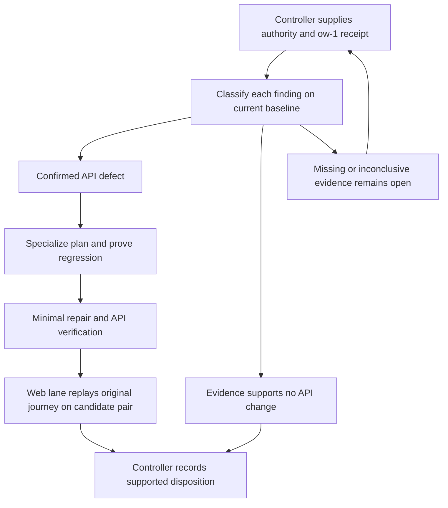

# Repair API defects from the web rehearsal - Plan

## Goal Capsule

- **Objective:** FOLIO and Catholic OS users can complete the web rehearsal journeys affected by confirmed API defects before the BAIF Rome demo on 2026-11-05/06.
- **Means:** Reproduce each reported failure, repair the responsible API boundary, and obtain a web replay on the repaired release pair (KTD1-KTD3).
- **Authority:** The controller's `oa-4` mandate and standing campaign rules govern scope; `AGENTS.md` governs repository work. Campaign authority sources missing from this clone are recorded in G1.
- **Execution boundary:** This stage delivers a plan only on `drawdown/oa-4`. The later build remains blocked on G1-G2 and must specialize U2 before changing application code.
- **Delivery owner:** The API lane commits locally; the controller scans, pushes, and opens the PR against current `dev`; the campaign gate owns review and merging (R6).
- **Stop conditions:** Missing or unreproduced findings cannot justify a repair. Keep the affected verification open when required inputs or an eligible runner are absent; continue independent preparation under R7.

**No concrete `ow-1` API defect is identified in the supplied checkout.**
This plan is a bounded intake and repair contract, not evidence that an API path is broken or that the rehearsal passed.

---

## Product Contract

### Summary

Resolve only API defects documented by the `ontokit-web` rehearsal item `ow-1`.
For each confirmed finding, add a regression at the failing boundary, make the smallest compatible correction, and link local verification to the web lane's replay.

### Problem Frame

The demo depends on the API and web client completing the same user journeys against a known release pair.
The mandate identifies rehearsal findings as the source of `oa-4`, but supplies no failing request, observed result, or expected behavior.
Historical test receipts and source inspection cannot fill that gap.

### Requirements

**Defect scope and behavior**

- R1. Every repair traces to a concrete `ow-1` API finding with a reproducible failure and an explicit expected result; a missing report does not establish either a defect or a pass.
- R2. Restore the reported user journey while preserving existing API contracts, access rules, and unaffected behavior.
- R3. Add tests that expose each confirmed defect and retain all existing tests and assertions; required regression, integration, lint, and type evidence must be truthful about failures and skips.
- R4. Closure requires the web lane to repeat the original journey against identified API/web revisions and observe the expected result, including durable or background effects when relevant.

**Campaign boundaries and delivery**

- R5. Keep artifacts public-safe and changes confined to `oa-4`: no spend, credential or security-setting changes, sends in the user's voice, force-push, or deletion without a verified backup. Never read forbidden credential material or files matching the campaign's `*.pem`, `*.key`, `.env*`, `twin-secrets/`, or secrets-directory restrictions (Campaign R11).
- R6. Preserve `drawdown/oa-4` as the item branch and leave publication and merging to the controller and campaign gate; never add a remote or seek credentials in this clone (Campaign R15, R17, R19).
- R7. Complete independent preparation while controller-owned evidence is missing; only a demonstrated person-only requirement belongs in a final decision request (Campaign R20).

### Key Decisions

- **Proceed without waiting for Damien.** Governs R7 (session-settled: user-directed — chosen over waiting for his input: he has zero time through 2026-10-30).
- **Keep the campaign's delivery and model decisions.** Governs R6. Local work uses Astra; cloud build stages use the default model and still receive Astra and Fable reviews (session-settled: user-directed — chosen over the Sol-first local ladder and a cloud model override: the campaign already settled these choices).

### Scope Boundaries

This item authorizes defect repair, not a search, suggestion, or review audit.
The route map below is a lookup aid, not a list of suspected bugs or planned edits.
No frontend change, workflow change, deployment activation, AWS provisioning, dependency upgrade, Python-target change, schema migration, data rewrite, package release, or new outside service is planned.
If a confirmed defect truly requires a held change under Campaign R15-R16, record the exact need and route it through the controller before expanding this plan; no such need is established here.

A generic error envelope, health-detail feature, blanket retry mechanism, and new diagnostic framework were considered and excluded because no rehearsal finding requires them.
Reconsider only if a concrete finding demonstrates that an existing contract cannot be restored without that mechanism.

### Deferred to Follow-Up Work

- `oa-0` owns OSV dependency repair; `oa-1` owns October 20 landing reconciliation; `oa-2` owns U9 deployment and acceptance evidence.
- `oa-3` owns local mypy environment drift; `oa-5` owns friendlier errors and health detail; `oa-6` owns broad coverage and audit work.
- Web-only defects remain with `ow-1`; environment or deployment faults go to the controller and their existing owner.
- Campaign R18's 2026-11-03 through 2026-11-06 expansion freeze and the settled hygiene-after-worthwhile-work policy remain unchanged; this item is planned work.

---

## Planning Contract

### Reverified Starting State

Static inspection on 2026-10-27 found a clean `drawdown/oa-4` at `ace5b9312e82530d902124308f6c57b7187e3e19`.
The local `dev` ref is `62469e0c4cb2d0d322b6fcaec9c1acbdd5e6ae15`, six commits behind this branch, and is not current upstream evidence.
There are no remotes or `origin/*` refs.
No tests, application imports, services, or live acceptance checks ran during planning.

| Source | Verified fact | Limit |
|---|---|---|
| `docs/plans/2026-09-30-fix-u9-evidence-reconciliation-plan.md` | Assigns rehearsal API defects to `oa-4` and separates source, deployment, and acceptance evidence | Its `oa-2` work is outside this item |
| `docs/handoffs/2026-10-05-lock-drift-guard-pr63.md` | Absent from the checkout and available path history | `docs/plans/2026-10-05-fix-dev-image-lock-drift-guard-plan.md` exists and was read; it does not replace the missing handoff |
| October 20 named `origin/*` branches | Unavailable in this clone | Corresponding merged commits are available: `49ff0bea` for OSV fixes, `38fc1307` for image deploy, `83af4be6` for AWS readiness |
| `docs/handoffs/2026-10-20-sweep-cloud-ontokit-api.md` | Records historical verification and explicitly says no deploy or host change occurred | Historical green results do not prove this checkout or current DEV |
| Local docs and available commit subjects | No concrete `ow-1` finding or earlier `oa-4` plan found | The web repository and its rehearsal receipts were not supplied |
| Chief campaign source | `docs/plans/2026-10-26-0705-feat-codex-drawdown-campaign-plan.md` and `ops/drawdown/mandates/_common.md` are unavailable | Campaign R-ID citations here refer to the user's supplied rules; their full source text has not been inspected |

### Blocking Inputs and Owners

| Gate | Needed input | Owner and effect |
|---|---|---|
| G1 | Chief plan Goal Capsule and cited Campaign R11/R15-R20, common mandate, and the missing October 5 handoff or explicit unavailable-source disposition | Controller; reconcile authority before code implementation or final acceptance |
| G2 | Completed `ow-1` report with concrete API findings, or explicit evidence that the rehearsed journeys exposed none; current upstream `dev` revision | Controller/web lane; identifies the actual work and baseline |
| G3 | Eligible regression/full-suite runner and release-bound verification receipts that respect R5 | Controller; required before dependent tests and acceptance claims |
| G4 | Original-flow replay against the repaired API/web pair, with the expected visible and durable outcomes | Web lane/controller; required for R4 closure |

G1-G2 are execution blockers, not details to infer during coding.
These inputs are not known to require Damien; no person-only decision is established.

### Finding Intake Contract

For each finding, record a stable ID, the report source and UTC observation time, environment, failing API/web commits, and separately the controller-supplied current `dev` commit.
Include the original user action sequence, HTTP method/path, safe query/body shape, expected versus actual status and response, and the expected visible result.
Record anonymous/authenticated classification, role, project visibility, branch/draft revision, index state, and asynchronous effects only where relevant to reproduction.
Use synthetic identifiers and ontology data; describe credential/header presence or class without recording values, browser storage, raw HAR files, or private response bodies.

Assign each finding an evidence-backed disposition:

- **Confirmed API defect:** the permitted reproduction fails at the API boundary on the selected current baseline; name the responsible layer and specialize U2.
- **Already fixed:** identify the correcting change and show the original reproduction passing on the current baseline.
- **Web/environment owned:** identify the owning lane and observation that establishes ownership; do not implement that work here.
- **Unresolved:** missing input, inconclusive reproduction, or unavailable execution keeps the finding open.

Only a completed `ow-1` receipt covering its intended journeys can support a no-API-defect outcome.
Absence of findings in this clone cannot support that outcome.

### Key Technical Decisions

- KTD1. **Select the repair from the reproduction.** Follow the intake contract before choosing files (R1). Refresh this plan with exact finding IDs, files, expected responses, and test scenarios before U2; a broad audit would exceed `oa-4`.
- KTD2. **Test the layer that fails.** Exercise the public request and actual faulty service or persistence boundary (R2-R3). Mock unrelated providers and paid integrations, not the code whose repair is being claimed.
- KTD3. **Separate three kinds of proof.** Retain reported-baseline evidence, candidate API regression results, and candidate web replay as distinct receipts (R3-R4). A green unit test or HTTP 200 alone cannot prove a persisted or asynchronous user outcome.
- KTD4. **Preserve current ownership and transaction boundaries.** Extend the existing route/service/schema and fixture patterns (R2). New retries, commit placement, authorization semantics, or background-job ordering require a finding-specific justification and matching tests.

### Existing Code and Test Map

Select only the row implicated by G2; every listed path exists at the inspected revision.

| Reported boundary | Implementation references | Existing test references |
|---|---|---|
| Global search or SPARQL | `ontokit/api/routes/search.py`, `ontokit/services/search.py`, `ontokit/schemas/search.py` | `tests/unit/test_projects_routes.py`, `tests/unit/test_search.py` |
| Project ontology search | `ontokit/api/routes/projects.py`, `ontokit/services/indexed_ontology.py`, `ontokit/services/ontology_index.py` | `tests/unit/test_projects_routes_extended.py`, `tests/unit/test_indexed_ontology.py`, `tests/unit/test_ontology_index_service.py` |
| Semantic search | `ontokit/api/routes/semantic_search.py`, `ontokit/services/embedding_service.py` | `tests/unit/test_embeddings_routes.py`, `tests/unit/test_embedding_service.py` |
| Suggestion submission/retry | `ontokit/api/routes/suggestions.py`, `ontokit/services/suggestion_service.py`, `ontokit/schemas/suggestion.py` | `tests/unit/test_suggestions_routes.py`, `tests/unit/test_suggestion_submission_content.py`, `tests/integration/test_suggestion_submission_recovery.py` |
| Pull-request review/merge | `ontokit/api/routes/pull_requests.py`, `ontokit/services/pull_request_service.py`, `ontokit/schemas/pull_request.py` | `tests/unit/test_pull_requests_routes.py`, `tests/unit/test_pull_request_service.py`, `tests/unit/test_pull_request_idempotency.py`, `tests/integration/test_pull_request_concurrency.py` |

`ontokit/main.py` owns `/api/v1` registration.
Route tests use dependency overrides; service and integration tests provide the deeper proof KTD2 requires.
Suggestion recovery tests observe fresh-session state after refusal and retry; PR concurrency tests exercise locking and allocation.
If G2 identifies a different endpoint, trace it and add its exact source/test paths to this plan before implementation.

### Repair and Acceptance Flow

### Assumptions and Deferred Details

The mandate is treated as authorizing the finite API findings produced by `ow-1`; the actual list is not yet known.
No specific endpoint, root cause, new behavior, performance target, or persistence change is assumed.
Exact implementation helpers and fixture values are deferred until the finding is supplied and its existing behavior traced.
No architecture choice depends on an unverified behavior trace at this stage.

---

## Implementation Units

### U1. Establish the rehearsal findings and specialize the repair

**Goal:** Turn the `ow-1` evidence into a bounded, executable API repair scope.
**Requirements:** R1, R5-R7. **Dependencies:** G1-G2 for implementation scope; independent documentation preparation may proceed.
**Files:** Update `docs/plans/2026-10-27-0908-fix-oa-4-rehearsal-api-defects-plan.md`; create `docs/plans/evidence/oa-4/findings.md` in the build stage using the intake contract.

**Approach:** Reconcile supplied authority and current baseline, classify each finding, and record its owner and evidence.
For confirmed API defects, amend U2 with the exact source/test file list, role/state preconditions, expected responses and effects, and affected compatibility contract.
If the report supports no change, retain the evidence and disposition without manufacturing an implementation.

**Patterns to follow:** The U9 reconciliation plan separates historical claims, current observations, and open gates.
**Test expectation:** No new automated test for intake documentation.
**Verification scenarios:** An old report is compared with current `dev`; an unavailable runner stays unresolved; an already-fixed claim includes the original reproduction passing; missing `ow-1` evidence never becomes a no-defect claim.
**Done:** Each reported finding has a supported disposition, and every proposed code change has a concrete test oracle and file list.

### U2. Repair each confirmed API defect with a regression

**Goal:** Restore the reported API behavior without breaking adjacent established behavior.
**Requirements:** R1-R3, R5-R6. **Dependencies:** U1, resolved G1-G2, and an eligible G3 runner for execution evidence.
**Files:** Only the affected implementation and test paths selected from the code map, plus finding-specific fixtures if needed. The exact list must be added here before this unit starts.

**Approach:** Trace the selected request through dependencies, service, state changes, and failure paths, then correct the responsible boundary under KTD2-KTD4.
Retain `/api/v1`, existing role gates, status/response conventions, and transaction or post-commit behavior unless the confirmed defect specifically concerns that contract.
Repeat this unit only for the enumerated API findings within `oa-4`.

**Execution note:** Establish a regression that fails for the reported mismatch before changing the application, and record baseline versus repaired results.
**Patterns to follow:** Use the selected row's route/service tests; for persistence or concurrency, use its real integration fixture rather than a fully mocked service.

**Required scenario shapes, to be replaced by finding-specific inputs and expected values before implementation:**

1. The reported request and synthetic role/state reproduce the mismatch on the baseline and yield the agreed response and effect after repair.
2. The nearest existing valid input still completes with its established response and state change.
3. The relevant invalid input or unauthorized role retains its existing rejection and lack of unintended writes.
4. If persistence/retry is implicated, a fresh session or read proves the intended state after success and refusal, and a repeat request preserves existing idempotency behavior.
5. If background work is implicated, verify the resulting user-visible read/job effect and the existing failure boundary rather than only queue invocation.

**Verification:** The selected scenarios execute the faulty layer and pass after repair, and affected existing tests remain intact and passing.
**Current limit:** U2 is not executable until U1 replaces its conditional file/scenario selection with concrete findings.

### U3. Verify the candidate and close the web-lane loop

**Goal:** Give the controller defensible proof that the reported user journey is repaired.
**Requirements:** R3-R7. **Dependencies:** U2 for repairs, G3 for required checks, G4 for browser acceptance; supported no-change outcomes use U1 evidence.
**Files:** Complete `docs/plans/evidence/oa-4/findings.md` with links to sanitized verification and replay receipts under `docs/plans/evidence/oa-4/`.

**Approach:** Apply the verification contract, recording source revisions and failures/skips separately from passes.
The web lane repeats the original action sequence on the candidate pair and records the visible result plus any relevant reload, fresh read, or background completion.
Return the local commits, residual gates, and evidence paths to the controller for scanning, review, publication, and the campaign merge gate.

**Test expectation:** No new test code solely for the receipt; execute U2's tests and required existing checks.
**Verification scenarios:** A mismatched release pair cannot close a finding; unavailable or skipped tests remain open; successful transport without the required durable effect does not pass R4; unrelated baseline failures are attributed without weakening their checks.
**Done:** Every confirmed finding has API proof and matching web proof, or an explicit unresolved gate; no open finding is reported fixed.

---

## Verification Contract

The following checks belong to the later build stage, not this planning commit.

| Check | Required proof and constraints |
|---|---|
| Regression and affected suites | Baseline mismatch and repaired pass for each finding; exact source/test IDs recorded after U1; mocked forwarding alone is insufficient for a service defect |
| Integration | Execute applicable PostgreSQL/Redis cases on isolated synthetic resources; missing-service skips in `tests/integration/conftest.py` do not count as passes |
| Existing full suite | `pytest tests/ -v --cov=ontokit`, using the repository's memory constraints; obtain controller/CI receipts for checks this lane cannot run safely |
| Lint and format | `ruff check ontokit/` and `ruff format --check ontokit/`, plus changed test files; retain repository rules |
| Types | `mypy ontokit/` is authoritative; `uv run pyright ontokit/` should report zero errors; preserve Python 3.11 and route unrelated environment drift to `oa-3` |
| Web replay | UTC time, environment, candidate API/web commits, synthetic fixture identity, original actions, and expected/actual visible and relevant durable results |
| Diff and review | Only `oa-4` changes, additive regression coverage, no weakened tests, public-safe artifacts, and controller-owned required CI/Astra/Fable review evidence |

**Runner constraints:** `ontokit/core/config.py` can read `.env` during import, and `tests/unit/test_migration_inventory.py` explicitly reads a tracked `.env.example` file.
Under R5, do not invoke those reads in this lane or alter tests to evade the restriction.
Use metadata-only absence checks before application imports and have the controller supply eligible existing CI/runner receipts for forbidden-reading tests and unavailable service tests.
If those receipts cannot be obtained, G3 remains open; a partial suite is never reported as the full suite.
Denied Unix sockets may also prevent HTTP/event-loop execution; distinguish that environment failure from an application assertion failure.
Fixture cleanup must respect R5's preservation requirement and never target live DEV data.

No frontend change is planned, so this stage has no screenshot requirement.
If a later scoped frontend change becomes necessary, coordinate ownership with the web lane, capture a Playwright screenshot of the changed page, commit it under `docs/plans/evidence/`, and report its exact path as `SCREENSHOT: <path>` (Campaign R16).

---

## Rollback and Delivery

The plan commit changes no runtime behavior.
A later repair should be reversible through its focused code commit without schema or data reversal; any exception must be recorded as a held change under the campaign rules.
No deployment, package publication, host mutation, or PR action is performed from this clone.
The controller owns the compatible API/web pairing, rollout, acceptance observation, and any operational rollback through existing procedures.

---

## Definition of Done

**Plan-stage delivery:** This plan is reviewed and committed locally on `drawdown/oa-4`; missing inputs and conditional implementation units remain explicit, and no application/test code is changed or executed.

**Repair completion:** G1-G2 are resolved, U1 identifies the finite API findings, and each confirmed defect satisfies R2-R4 through executed tests and matching web replay.
The controller has the required quality/review evidence and publishes through R6.
The branch contains only the assigned work, with no abandoned implementation attempts or unrelated edits; removal of any such material still follows R5.

**Supported no-change completion:** A completed `ow-1` receipt and current-baseline evidence establish that no API repair remains within the reported scope.
This is a documented disposition, not an implemented fix.

Until those inputs exist, implementation and acceptance remain blocked on controller evidence.
Committing this plan does not close `oa-4` or certify demo readiness.
