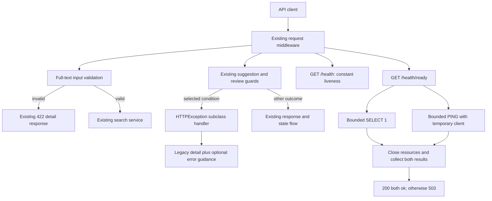

# Demo API errors and dependency health - Plan

## Goal Capsule

- **Objective:** BAIF Rome demo participants can understand selected search, suggestion, and review failures and take the next safe action; operators can distinguish a responsive API from unavailable backing dependencies.
- **Means:** Earlier search validation, additive guidance for explicit suggestion/review refusals, and a separate dependency-readiness endpoint (KTD1–KTD4).
- **Authority:** The controller's `oa-5` mandate and supplied campaign rules govern scope; repository `AGENTS.md` governs implementation. The chief repository's `docs/plans/2026-10-26-0705-feat-codex-drawdown-campaign-plan.md` Goal Capsule and Campaign R11, R15–R20 remain an unavailable source to reconcile at G1.
- **Execution boundary:** This delivery is a committed plan only. Later implementation stays on `drawdown/oa-5`; the controller publishes to `dev` and the campaign gate handles merging under R9.
- **Stop conditions:** Preserve the existing contracts in R3 and the boundaries in R8. A missing controller receipt blocks the dependent release conclusion, not independent implementation or documentation. No live readiness, browser, or acceptance result is claimed by this plan.

---

## Product Contract

### Summary

Reject invalid full-text search inputs at the request boundary, explain selected suggestion and review refusals without changing their existing error detail, and add bounded database/Redis readiness checks alongside liveness.
Document the response contract for the `ontokit-web` lane and verify compatibility before release.

### Problem Frame

The demo depends on search, suggestion submission, and review being understandable when an action cannot proceed.
The current full-text route constructs a constrained schema after request validation, while expected service failures use several established response shapes.
The existing health endpoint always reports a healthy process and cannot explain a database or Redis outage.
These source observations justify a focused improvement; they are not evidence of a current DEV incident or a measured production latency problem.

### Requirements

**Search and recovery guidance**

- R1. Invalid full-text search inputs return the standard request-validation 422 before the search service executes SQL; valid search behavior remains unchanged.
- R2. The explicit suggestion/review conditions in KTD2 return a stable code, clear message, safe next action, and request correlation alongside their existing response detail.
- R3. Preserve existing HTTP statuses, `detail` values and types, supplied headers, permission gates, and successful responses. R1 intentionally corrects invalid-input handling; unrelated errors and existing whole-body response assertions remain unchanged.

**Health and resource behavior**

- R4. `/health` retains exact HTTP 200 with `{"status":"healthy"}`, without dependency probes.
- R5. A separate `/health/ready` reports current database and Redis connectivity independently, returning 200 only when both checks pass and 503 otherwise.
- R6. Readiness checks are bounded, read-only, and public-safe. They must not imply that worker execution, authentication, git storage, project indexes, or model providers are ready.

**Verification and campaign boundaries**

- R7. Add tests for every new behavior while retaining all existing tests and assertions. Publish a web-consumer contract and distinguish automated evidence, environment limitations, and controller acceptance.
- R8. Work only `oa-5`: no migrations, data rewrites, dependency upgrades, package releases, new outside services, AWS provisioning, spend, credential discovery, security-setting changes, sends in Damien's voice, force-push, or deletion without a verified backup. Keep artifacts public-safe and obey Campaign R11's forbidden-file rules.
- R9. Deliver one expansion on `drawdown/oa-5`; local work ends at commits. The controller scans, pushes, and opens the PR, with campaign merge/review gates and the 2026-11-03 through 2026-11-06 expansion freeze intact (Campaign R15–R19).
- R10. Complete independent work without waiting for Damien through 2026-10-30. Route missing campaign excerpts and companion verification to the controller; report a proven person-only blocker using Campaign R20's decision format.

### Key Decisions

- **Expansions merge through guardrails.** Governs R7–R9 (session-settled: user-directed — chosen over holding every expansion for personal review: the campaign merge gate supplies the review boundary).
- **Keep progressing while controller inputs are missing.** Governs R10 (session-settled: user-directed — chosen over waiting for Damien: he has zero time through 2026-10-30).
- **Finish the assigned item without speculative additions.** Governs R8 (session-settled: user-directed — chosen over speculative features after worthwhile work runs out: later campaign capacity goes to durable hygiene).

### Scope Boundaries

Application changes are limited to full-text search validation, the selected exception classifications, their response adapter, and dependency readiness.
No frontend implementation is planned, so no changed-page screenshot is required in this API branch.
Any separately authorized frontend change must satisfy Campaign R16 with a committed Playwright screenshot under `docs/plans/evidence/` and a `SCREENSHOT:` receipt.

**Considered and not built:**

- A global error-envelope replacement would touch unrelated clients and exact response contracts; use the opt-in exception type instead. Reconsider only under a separately scoped API contract migration.
- Whole-request timeouts, retries, and health-based write gates would interfere with operations that can already have durable or paid effects. They are unnecessary for the defined early-validation and diagnostic outcomes.
- A cached health state or circuit breaker would introduce recovery semantics without evidence that this low-cost diagnostic endpoint needs them. Reconsider only with measured probe load or outage behavior.
- Worker heartbeats, provider test calls, MinIO bucket checks, and per-project readiness aggregation would overstate what this item can verify or add effects. Existing member-gated LLM status, index status, and suggestion capabilities remain separate sources.
- Bulk review's HTTP 200 partial results and generation's transient HTTP 200 empty-suggestion fallback remain intact; the error adapter does not upgrade these response bodies.

#### Deferred to Follow-Up Work

`oa-0` owns scanner repairs; `oa-1` the October 20 landing work; `oa-2` live U9 acceptance; `oa-3` local mypy drift; `oa-4` rehearsal defects; `oa-6` broader endpoint coverage and audits.
The eager ARQ acquisition in suggestion submit/resubmit is a separate performance candidate, not part of this change.
Web presentation of the new guidance belongs to the companion lane; its compatibility check at G2 is required here, but a new UI is not.

---

## Planning Contract

### Reverified Starting State

Static inspection on 2026-10-27 found clean branch `drawdown/oa-5` at `ace5b9312e82530d902124308f6c57b7187e3e19`.
The local `dev` ref is `62469e0c`, six commits behind this branch, and is not a freshly fetched upstream baseline.
No remote or `origin/*` refs exist. No tests, application imports, dependency installation, or live probes were run during planning.

| Evidence | Verified fact | Planning implication |
|---|---|---|
| `ontokit/api/routes/search.py`; `ontokit/schemas/search.py` | `q`, `limit`, and `offset` lack equivalent route bounds; `SearchQuery` requires length at least 1, limit 1–100, and nonnegative offset | Move these same constraints to request validation; preserve tokenization and query semantics |
| `ontokit/services/search.py`; `tests/unit/test_search.py` | Public-project full-text search sanitizes punctuation, preserves empty-result cases, and has service tests | Add HTTP-level regression coverage instead of altering the search algorithm |
| `ontokit/main.py`; `ontokit/core/exceptions.py` | Domain errors use `error`; ordinary HTTP errors use `detail`; development re-raises unexpected exceptions | Add a narrow handler, retaining both existing families and development behavior |
| `tests/unit/test_embeddings_routes.py`; `tests/integration/test_suggestion_submission_recovery.py` | Pricing/budget errors include exact full-body expectations | Leave those errors unchanged, including semantic search and suggestion duplicate validation |
| `ontokit/services/suggestion_service.py`; `ontokit/services/pull_request_service.py` | Selected state/limiter/review guards use HTTPException; bulk handling catches that base type | Subclass HTTPException and preserve each original detail and catch path |
| `ontokit/main.py`; `tests/unit/test_health.py`; `tests/unit/test_main.py` | Liveness is an exact constant response; startup checks are separate | Keep liveness and its assertions untouched |
| `Dockerfile`; `Dockerfile.prod`; `deploy/compose.dev.yaml` | Deployment healthchecks call `/health` | A readiness failure must not change restart or deployment policy |
| `ontokit/main.py`; `ontokit/api/utils/redis.py` | Failed optional Redis startup leaves the startup pool unset; ARQ has a separate lazy pool | A live readiness probe must not rely on the startup snapshot or initialize ARQ |
| `49ff0bea`, `38fc1307`, `83af4be6` | October 20 OSV fixes, image-deploy contract, and AWS readiness work are present in ancestry | Treat them as existing baseline, without re-landing or modifying them |

Read source plans include `docs/plans/2026-09-30-fix-u9-evidence-reconciliation-plan.md`, `docs/plans/2026-10-20-sweep-api-readiness-plan.md`, and `docs/plans/2026-10-05-fix-dev-image-lock-drift-guard-plan.md`.
The available `docs/handoffs/2026-10-20-sweep-cloud-ontokit-api.md` reports historical results, not current acceptance.
The requested `docs/handoffs/2026-10-05-lock-drift-guard-pr63.md` is absent from this checkout and available path history; the requested October 20 `origin/*` branches are unavailable, so their merged history supplied the context.
The chief campaign plan and `ops/drawdown/mandates/_common.md` were not found in the supplied source directories.
Campaign R-ID references in this plan identify the controller-supplied rules, not a claim that their unavailable full text was inspected.

### Key Technical Decisions

- KTD1. **Use an opt-in HTTP exception adapter.** Extend the existing HTTPException family with explicit code/message/recovery metadata and register a handler for that subclass only (R2–R3). Preserve `detail` as-is, including nested `reason` or uppercase `code`, and forward supplied response headers. Add a sibling `error` object containing `code`, `message`, `recovery`, and `request_id`. Reuse request state from `RequestIDMiddleware`; do not introduce a second identifier or infer causes by matching message text. Leave ordinary HTTP exceptions, request validation, domain exceptions, rate limiting, and the unexpected-exception handler unchanged.
- KTD2. **Classify only established guards.** Use the table below at the point where the condition is already known (R2–R3). Keep validation, authorization, lock refresh, quota consumption, git writes, and transaction ordering unchanged. Supply curated guidance; never copy a new raw exception string into it. No `retryable` field or automatic retry is introduced: even limiter refusal can follow paid duplicate validation.
- KTD3. **Fail invalid search requests before search work.** Match the existing `SearchQuery` constraints in FastAPI's query parameter declarations (R1). Missing, empty, nonnumeric, or out-of-range inputs keep the standard 422 detail array. Whitespace and punctuation are not newly rejected. Dependency construction may still occur; the measurable guarantee is zero search-service calls and SQL execution for invalid requests.
- KTD4. **Probe current dependencies separately from liveness.** Implement a small injectable health service using the existing async database engine and a temporary async Redis client with the existing configured DSN (R4–R6). Perform only `SELECT 1` and `PING`; never initialize ARQ or alter the startup Redis pool. Run the two checks concurrently, close/release request-owned resources, and retain both results when one fails. Each probe has a one-second operation budget plus at most 250 ms cleanup allowance; set matching connect/socket limits where supported and add no retry loop. Cancellation must propagate after cleanup rather than become a successful response. The complete controlled-stall verification target is two seconds, not a hard-real-time promise about uncooperative drivers.
- KTD5. **Retain the campaign's execution model choices.** Local campaign work uses Astra rather than the Sol-first ladder; cloud build stages use the default Sol and still receive Astra/Fable review before merge (session-settled: user-directed — chosen over applying the local model ladder to cloud builds: the 2026-10-26 campaign answer sets the cloud route). This plan stage does not claim that those later code reviews occurred.

KTD2's adopted conditions are deliberately narrower than all suggestion/review failures:

| Guard and existing owner | Status and legacy detail | New stable code | Recovery guidance |
|---|---|---|---|
| Authenticated submit wrong lifecycle, both initial and locked refresh checks in `SuggestionService.submit` | 400; existing string | `suggestion_not_submittable` | Refresh the suggestion and check its current state before another submit |
| No changes in `SuggestionService.submit` and its anonymous counterpart | 400; existing string | `suggestion_no_changes` | Make and save an edit before submitting |
| Untrusted-submission limiter unavailable | 503; existing object with `reason=submission_limiter_unavailable` | `submission_limiter_unavailable` | Check current suggestion state and try later; do not claim no prior effects |
| Untrusted-submission daily limit reached | 429; existing object with `reason=daily_limit_reached` | `submission_limit_reached` | Wait for the existing daily reset; do not invent a cooldown value |
| Closed/merged PR in `PullRequestService.create_review` | 400; existing string | `pull_request_not_open` | Refresh the PR and check whether it is closed or merged |
| Insufficient approvals in the shared authorized merge implementation | 400; existing string including counts | `approvals_required` | Obtain the required reviews before attempting to merge |
| Unsuccessful git merge in the same shared implementation | 409; existing detail | `merge_failed` | Review the current branches and merge result, resolving any reported conflicts before another attempt |

The shared merge implementation also serves suggestion approval; preserve the different permission policies of direct PR review and suggestion review.
Anonymous no-change guidance changes neither token checks nor honeypot behavior.
The selected original tests assert their statuses and detail values; the exact whole-body pricing/budget contracts remain outside this table.

### Health Response Contract

For R5–R6, return `scope: "dependencies"`, `status: "ready"` or `"not_ready"`, a `request_id`, and `checks.database` / `checks.redis` with one of `ok`, `unavailable`, or `timeout` and a fixed safe message.
A connection refusal or a failed cleanup is `unavailable`; an exceeded operation budget is `timeout`.
HTTP 200 requires both checks to finish successfully, including cleanup; all other completed probe outcomes return 503.
Use `Cache-Control: no-store` so responses describe the current observation.
Do not include addresses, DSNs, SQL text, exception messages, stack traces, queue contents, tenant names, or project/provider configuration in responses or newly added failure logs.

### High-Level Technical Design

### Assumptions

These are bounded planning choices derived from the mandate, not additional user-confirmed product requirements:

- “Faster” means immediate rejection of schema-invalid search input and bounded dependency diagnostics. No production p95 claim or search-ranking optimization is intended.
- “Review” covers the existing suggestion-approval and pull-request review/merge paths. It does not expand PR Party, translation, or model-generation behavior.
- The API should supply useful guidance now, with browser presentation verified by the companion lane. The absent frontend has not been assumed to ignore the new `error` field safely.

### Controller Dependencies and Deferred Evidence

| Gate | Owner and needed evidence | Boundary |
|---|---|---|
| G1 | Controller supplies the campaign Goal Capsule and cited R11/R15–R20, plus an unavailable-source disposition or copy of the October 5 handoff | Reconcile before publication; independent code and test work can use the supplied mandate |
| G2 | `ontokit-web` lane checks its actual error parser against the old and new payload fixtures | Establish consumer compatibility before release; do not claim visible browser improvement from API tests alone |
| G3 | Controller provides current `dev` and the final required CI/review receipts | Reconcile branch drift, test baseline, and campaign merge eligibility; this clone must not add a remote or find credentials |

None of these inputs currently establishes a decision only Damien can supply.
Actual driver cancellation behavior, full-suite availability in the build sandbox, and current DEV connectivity remain execution-time evidence rather than planning claims.

---

## Implementation Units

### U1. Add the compatibility-preserving error adapter

**Goal:** Make classified errors informative without replacing existing error families.
**Requirements:** R2–R3, R7–R8. **Dependencies:** None.
**Files:** `ontokit/core/exceptions.py`, `ontokit/main.py`, new `ontokit/schemas/errors.py`, `tests/unit/test_exceptions.py`, and new `tests/unit/test_api_error_guidance.py`.

**Approach:** Implement KTD1 with an HTTPException subclass and a dedicated handler.
Describe the optional metadata in a reusable error schema: unclassified failures at the same status can still have only legacy detail.
Keep response serialization separate from domain decisions; U3 supplies the classifications.

**Execution note:** Start with HTTP contract tests through the application middleware, not handler-only tests.
Use the existing ASGITransport/dependency-override style in `tests/unit/test_suggestions_routes.py`; do not introduce socket-dependent tooling for new tests.

**Test scenarios:**

1. A classified failure with string detail preserves status/detail, returns its explicit guidance, and has matching body/header request IDs.
2. A classified failure with nested detail preserves the object exactly, including `reason`, `code`, counts, and any supplied `Retry-After` or authentication header.
3. Supplied and generated request IDs follow existing middleware behavior, and configured-origin CORS behavior remains intact without changing CORS settings.
4. Plain HTTP errors, standard validation errors, existing domain errors, and success/204 responses keep their original bodies; existing unexpected-error development and production tests still pass.
5. Error schema documentation marks guidance as optional; an unrelated route or bare HTTPException does not acquire it.

**Verification:** Added full-stack HTTP tests demonstrate selective registration and backward-compatible detail handling; all existing exception/main tests pass unchanged.

### U2. Validate full-text search input before executing search

**Goal:** Give callers fast, useful validation feedback for invalid search arguments.
**Requirements:** R1, R3, R7–R8. **Dependencies:** None; may proceed independently of U1.
**Files:** `ontokit/api/routes/search.py` and new `tests/unit/test_search_routes.py`; retain `tests/unit/test_search.py` as regression coverage.

**Approach:** Apply KTD3 at the existing GET search route.
Keep `SearchQuery` as the service contract and leave semantic search, SPARQL, SQL construction, ranking, and result schemas untouched.

**Test scenarios:**

1. Missing or empty `q`, `limit=0`, `limit=101`, negative offset, and nonnumeric paging inputs return standard 422 details with no search-service invocation or SQL execution.
2. Boundary limits 1 and 100, offset 0, and ordinary queries reach the service with the same parsed values and preserve the response schema.
3. Whitespace and punctuation-only queries retain existing valid-input/empty-result semantics rather than acquiring a new rejection rule.
4. Existing comma-separated ontology/entity filters and normal default paging are forwarded unchanged.

**Verification:** HTTP regression coverage proves early refusal; existing full-text, semantic-search, and SPARQL tests remain green.

### U3. Explain selected suggestion and review refusals

**Goal:** Tell a contributor or reviewer what to do next for the KTD2 conditions.
**Requirements:** R2–R3, R7–R8. **Dependencies:** U1.
**Files:** `ontokit/services/suggestion_service.py`, `ontokit/services/pull_request_service.py`; response documentation in `ontokit/api/routes/suggestions.py`, `ontokit/api/routes/anonymous_suggestions.py`, and `ontokit/api/routes/pull_requests.py`; tests in `tests/unit/test_suggestion_service.py`, `tests/unit/test_suggestions_routes.py`, `tests/unit/test_anonymous_suggestions_routes.py`, `tests/unit/test_pull_request_service.py`, `tests/unit/test_pull_request_service_extended.py`, and `tests/unit/test_pull_requests_routes.py`.

**Approach:** Replace only the selected exception constructions using KTD2, preserving their current guard positions and original payloads.
Add optional error-schema references for the relevant OpenAPI responses.
Keep service signatures, ARQ acquisition, permission policies, catch paths, and successful response models intact.

**Test scenarios:**

1. Both initial and refreshed-under-lock wrong-state submit guards retain 400 detail and carry the same `suggestion_not_submittable` classification.
2. Authenticated and anonymous no-change submissions retain their existing refusal and receive `suggestion_no_changes`; missing/invalid tokens and honeypot responses are unchanged.
3. Limiter outage and exhaustion preserve the exact 503/429 detail objects, fail-closed behavior, and allowance-consumption order; their guidance distinguishes outage from daily reset without claiming no prior effects.
4. Closed/merged PR review preserves 400, approval shortfall preserves its status/count detail, and merge conflict preserves 409; each receives the KTD2 code through a real classified exception and the HTTP handler.
5. The shared merge refusal remains available through suggestion approval while direct-review and suggestion-review role restrictions remain different and unchanged.
6. Bulk review keeps HTTP 200 partial results and continues after a refused row; changing the exception class does not bypass its HTTPException catch or rollback behavior.
7. Existing exact-body pricing/budget refusals, submission success, and 201/204 review responses remain unchanged. A service raising after a simulated durable effect is invoked only once, with no new retry or timeout wrapper.

**Patterns:** Existing service-level HTTPException assertions and route dependency overrides; partial-success coverage in `tests/unit/test_suggestion_trust_integration.py`.
**Verification:** Existing guard assertions remain intact, added classification/HTTP assertions pass, and integration recovery/concurrency tests retain their original guarantees when run with their required services.

### U4. Add current, bounded dependency readiness

**Goal:** Explain backing-service outages without changing liveness or deployment behavior.
**Requirements:** R4–R8. **Dependencies:** None; use the existing request-ID middleware, not U1's error adapter.
**Files:** `ontokit/main.py`, new `ontokit/services/health.py`, new `ontokit/schemas/health.py`, `tests/unit/test_health.py`, and new `tests/unit/test_health_service.py`.

**Approach:** Implement KTD4 and the Health Response Contract with injectable probe boundaries.
The route gets structured results from the service, so HTTP tests need neither lifespan startup nor live infrastructure.
Use the existing lifecycle's async connection/timeout patterns without changing that lifecycle or its shared pools.

**Test scenarios:**

1. Both probes pass: return 200 with two `ok` checks, dependency scope, request correlation, and no-store. Existing `/health` remains byte-for-byte equivalent in JSON and performs no probe.
2. Database failure, Redis failure, or both failures return 503 with independent outcomes and fixed safe messages; one failed check does not erase the other's result.
3. A controlled connection-acquisition, query, or ping stall exhausts its budget, returns the appropriate timeout result, and releases owned resources. Two stalled checks run concurrently and complete within the controlled two-second target, including cleanup.
4. Cleanup failure or a controlled cleanup stall cannot yield `ready`; cleanup stays bounded and leaves no detached tasks or request-owned connections.
5. Redis fails on one request and recovers on the next, including when the startup pool is unset. Neither the startup pool nor the ARQ pool is modified.
6. Cancelling the request propagates cancellation after cleanup; it does not return a fabricated health result or retain background probe tasks.
7. Exceptions containing synthetic DSNs, credentials, SQL, or stack text leak none of those values into the new response or new failure logs.
8. No storage operation, provider call, queue initialization/enqueue, schema check, git write, or application-data mutation occurs during readiness.

**Verification:** Service tests prove probe ownership and cooperative deadlines; HTTP tests prove status/body semantics. Do not promote mock results into current DEV health or a universal driver timing guarantee.

### U5. Document the consumer contract and record release evidence

**Goal:** Give the web lane and controller a usable, honest contract and acceptance receipt.
**Requirements:** R7–R10. **Dependencies:** U1–U4; G1–G3 for the relevant release conclusions.
**Files:** `README.md`, new `docs/api/demo-feedback.md`, and a sanitized build receipt at `docs/plans/evidence/oa-5/verification.md`.

**Approach:** Document the KTD2 coverage, unchanged error families, optional guidance schema, and Health Response Contract.
Include synthetic old/new payload examples for web-parser verification and explain safe fallback to legacy detail.
Link the contract from the README; keep existing deployment healthchecks untouched.
Record the exact checked revision, commands/results, skips and environmental limits, controller/web receipts, and outstanding gates.

**Test expectation:** No separate documentation-only test; use U1–U4's HTTP/OpenAPI contracts as the source of truth.
**Verification scenarios:** A legacy parser still handles selected errors; a consumer understands that readiness does not certify worker/provider/index success; missing controller or live evidence remains explicitly unverified.
**Verification:** G2 has a companion compatibility receipt before release, and the final report distinguishes API implementation completion from web display and DEV acceptance.

---

## Verification Contract

These checks belong to the build stage. The plan stage runs only static source/history and document checks.

| Check | Required evidence |
|---|---|
| Focused error/HTTP tests | New `test_api_error_guidance.py`, `test_search_routes.py`, and `test_health_service.py`, plus the existing tests named in U1–U4; each new behavior has an observable assertion |
| Whole regression suite | `uv run pytest tests/ -v --cov=ontokit`; record the baseline and final outcomes and every skipped integration prerequisite |
| Formatting/lint | `uv run ruff check ontokit/ tests/` and `uv run ruff format --check ontokit/ tests/`; no unrelated formatting or ignored regressions |
| Authoritative typing | `uv run mypy ontokit/`, retaining the repository's Python 3.11 target and Pydantic plugin |
| Advisory typing | `uv run pyright ontokit/`, with zero errors; route known environment drift to the controller/`oa-3`, without changing dependency or Python targets here |
| Contract and latency proof | Full ASGI request/response tests, original detail/body assertions, controlled concurrent-stall and resource-cleanup tests, and generated OpenAPI coverage |
| Stateful regression evidence | Existing `tests/integration/test_suggestion_submission_recovery.py` and `tests/integration/test_pull_request_concurrency.py` run against authorized disposable PostgreSQL/Redis when available; no live demo writes or paid provider calls |
| Companion compatibility | G2 verifies actual `ontokit-web` parser behavior on old/new synthetic fixtures, including any parser branch selected by presence of `error` |
| Delivery guardrails | G1/G3 reconcile missing sources, current upstream state, required checks/reviews, and freeze eligibility under R9 |

Use dependency caches through `XDG_CACHE_HOME` and existing toolchains; do not discover credentials or read forbidden files to make tests run.
If socket restrictions produce errors such as `Failed to create stream fd`, report the exact blocked checks and obtain controller-side evidence rather than modifying or weakening existing tests.
A skipped or environment-blocked check is not a pass, and source inspection does not substitute for runtime verification.

---

## Rollback and Risks

The change has no persistent schema or data transformation; reverting its application/docs changes restores the previous API behavior.
New error fields are optional, so companion code must retain the legacy fallback across rollback.
The new readiness route is diagnostic and is not wired into deployment or restart policy.

The principal risks are frontend parser precedence, accidental changes to HTTPException catch behavior, and resource cleanup under cancellation.
G2, U3's unchanged recovery/bulk tests, and U4's lifecycle tests address these directly.
Health success remains a connectivity observation; current DEV acceptance continues to belong to `oa-2`.

---

## Definition of Done

The implementation delivers R1–R7 with new behavioral tests and preserves the existing suite, type checks, successful response shapes, and guarded write semantics.
U1–U5 include no unrelated lane work or abandoned experimental implementation.
The build receipt distinguishes completed checks from blocked or skipped checks, and the controller has G1–G3 before the corresponding publication/release conclusions.
R8–R10 remain satisfied, including the expansion freeze and local-only publication boundary.
No migration, data rewrite, new service, package release, or held change is anticipated.

For this stage, completion is the reviewed plan committed locally on `drawdown/oa-5`; it is not an implementation, test-pass, deployment, or acceptance claim.
