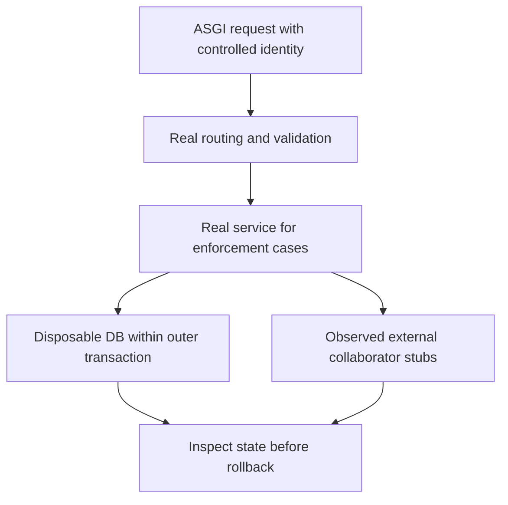

# Cover suggestion and review boundaries - Plan

## Goal Capsule

- **Objective:** Contributors and reviewers can rely on the existing suggestion workflow for the BAIF Rome demo, and maintainers can identify its remaining dependency and security risks from current evidence.
- **Means:** Add focused HTTP and persistence coverage, verify the documented PR review access boundary, and record a reproducible audit (KTD1–KTD5).
- **Authority:** The controller's oa-6 mandate and supplied campaign rules govern scope; repository `AGENTS.md` governs local work. The chief campaign source gap is recorded under Controller dependencies.
- **Delivery:** One hygiene item on `drawdown/oa-6`. This stage produces only the committed plan; the later build uses `lfg` on this plan. The controller scans, pushes, opens the PR against `dev`, and applies the campaign merge gate.
- **Stop conditions:** Keep failed, skipped, or unavailable verification visible. Stop only dependent work when a required test environment, source, or safety prerequisite is missing; continue the independent units under R6–R8.

The mandate calls oa-6 hygiene; `kind: planned` identifies existing mandated work rather than an expansion.
This document contains no new test-run, vulnerability-scan, or DEV acceptance result.

---

## Product Contract

### Summary

Extend the existing tests for authenticated and anonymous suggestion sessions, suggestion review decisions, and human PR reviews.
Add a small real-database boundary suite and a dated dependency/security audit with explicit findings and execution limits.

### Problem Frame

The repository already contains substantial suggestion-service and review-service tests, but many endpoint contracts are checked only through direct service calls or mocked services.
Those tests do not establish that HTTP validation, project isolation, authorization, and persisted effects agree at the request boundary.
The October 20 clean-scan receipt also cannot establish the present dependency risk: advisories and the checked-out baseline can change independently.

### Requirements

**Coverage and existing behavior**

- R1. Reverify the current branch, endpoint inventory, existing tests, and build-stage baseline before adding coverage; preserve every existing test and assertion.
- R2. Cover missing suggestion HTTP behavior with valid and invalid requests, including queue/capability responses, review payloads, partial-success bulk responses, submission failures, and anonymous token binding.
- R3. Prove project/user isolation and denied-write invariance through real authorization and persisted state, with authorized controls that demonstrate the assertions can observe a change.
- R4. Verify the documented PR review permissions and terminal-state restrictions. If the private-project nonmember comment-review violation is reproduced, correct only that missing view-access check and retain its regression test.

**Audit and evidence**

- R5. Audit the complete `uv.lock` inventory and application security using the existing OSV/Semgrep approach; preserve findings, rule coverage, scan errors, and applicability distinctions without adding suppressions or upgrading dependencies.
- R6. Record current revision, environment, invocation, outcomes, coverage changes, and unresolved findings in public-safe evidence; skipped tests and incomplete scans never count as passes.

**Campaign boundaries**

- R7. Keep the branch within oa-6: no frontend, new migration, data rewrite, package release, outside service, provisioning, workflow weakening, or unrelated dependency change. Do not alter authentication policy, credentials, or security settings.
- R8. Use the controller's publication/access boundary: no remote or login discovery, spend, sends in the user's voice, force-push, forbidden-file reads, or deletion without a verified backup. Complete independent work without waiting for Damien.

Campaign trace: R7–R8 carry the supplied Campaign R11 and R15–R20 constraints; R1–R6 carry oa-6's test-coverage and audit mandate.
Local R-IDs in this document are distinct from Campaign R-IDs.

### Key Decisions

- **Deliver durable hygiene.** Governs R1–R7 (session-settled: user-directed — chosen over speculative features: oa-6 is the assigned hygiene item).
- **Continue independent work.** Governs R6–R8 (session-settled: user-directed — chosen over waiting for Damien: he has zero time through 2026-10-30).
- **Preserve the campaign review path.** Governs R8. Local work uses Astra rather than the rejected Sol-first ladder; a later Codex Cloud build uses its default Sol model and still receives Astra and Fable reviews (session-settled: user-directed — chosen over changing the settled model/review allocation).

The settled policy allowing guarded expansion merges remains unchanged; this branch does not introduce an expansion.
Campaign R18's 2026-11-03 through 2026-11-06 expansion freeze remains in force.

### Scope Boundaries

The endpoint scope is `ontokit/api/routes/suggestions.py`, `ontokit/api/routes/anonymous_suggestions.py`, and the GET/POST human-review endpoints in `ontokit/api/routes/pull_requests.py`.
Translation reviews, PR-party workflows, LLM configuration endpoints, and frontend UX are separate surfaces.
Existing LLM-review regressions remain supporting tests for suggestion submission; this plan adds no provider call or new LLM behavior.

The only conditional production edit is R4's missing view-access enforcement in `ontokit/services/pull_request_service.py`.
Other audit discoveries receive reproducible findings and a controller-owned disposition; they do not authorize a broader security refactor.
Keep `uv.lock`, `pyproject.toml`, `.python-version`, `.github/workflows/`, scanner configuration, and existing suppressions unchanged.

A new test framework, coverage-percentage gate, retry mechanism, audit service, or authorization abstraction is considered and not built: existing fixtures, helpers, scanners, and observable test failures serve this item.
Reconsider only if a concrete failure prevents proving an existing contract, with the controller resolving any scope change.

#### Deferred to Follow-Up Work

oa-0 owns dependency remediation, oa-1 the October 20 landing checks, oa-2 DEV acceptance, oa-3 mypy environment drift, oa-4 rehearsal defects, and oa-5 demo-path error/health improvements.
Do not claim oa-6 completes any of those items.

---

## Planning Contract

### Reverified Starting State

Static inspection on 2026-10-27 found a clean `drawdown/oa-6` at `ace5b9312e82530d902124308f6c57b7187e3e19`.
Local `dev` is `62469e0c4cb2d0d322b6fcaec9c1acbdd5e6ae15`, six commits behind this branch; it is not a refreshed upstream baseline.
The clone has no remotes or `origin/*` refs.
No tests, application startup, dependency installs, or scanners ran during planning.

| Source | Observed state | Planning consequence |
|---|---|---|
| `docs/plans/2026-09-30-fix-u9-evidence-reconciliation-plan.md` | U9 distinguishes repository evidence from actual DEV acceptance | Local tests and scans cannot establish demo acceptance |
| `docs/plans/2026-10-05-fix-dev-image-lock-drift-guard-plan.md` and commit `b14d30f1` | Lock-drift plan and implementation exist | Preserve the guard; the requested October 5 handoff is missing |
| Commits `49ff0bea`, `38fc1307`, `83af4be6` | OSV/mako-virtualenv fixes, image-deploy contract, and AWS readiness are ancestors | Inspect merged contents instead of unavailable October 20 `origin/*` branches |
| `docs/handoffs/2026-10-20-sweep-cloud-ontokit-api.md` | Historical suite and zero-finding OSV receipts | Historical evidence only; rerun at build time |
| `.python-version`, `pyproject.toml`, `.github/workflows/release.yml` | Default runtime 3.13; minimum and type-check target 3.11; lint CI explicitly selects 3.11 | Record interpreter differences; retain authoritative strict mypy and advisory pyright |
| `tests/integration/conftest.py` | Real DB/Redis fixtures skip without configuration; ordinary session rollback follows yield | Existing teardown cannot undo route/service commits |
| Scanner workflows and `.semgrepignore` | OSV action v2.3.5; Semgrep authenticated policy or explicit fallback packs; tests/docs/generated migrations excluded | Retain configurations and describe local-versus-CI scope accurately |

Selected lockfile versions are certifi `2026.7.22`, filelock `3.32.3`, gitpython `3.2.0`, setuptools `84.0.0`, virtualenv `21.14.11`, and mako `1.4.3`.
These are source inventory observations, not fresh vulnerability determinations.
The first five overlap oa-0's reported advisories; U5 must reconcile current findings with that lane instead of duplicating its upgrades.
Neither `osv-scanner` nor `semgrep` was available on PATH during planning.

### Existing Coverage and Selected Gaps

| Boundary | Existing tests and limit | Added proof |
|---|---|---|
| Authenticated suggestion routing | `tests/unit/test_suggestions_routes.py` exercises reopen and resubmit over HTTP with a mocked service | Validation, response shape, review decisions, submission-outage mapping |
| Suggestion ownership/review rules | `tests/unit/test_suggestion_service.py` and `tests/unit/test_suggestion_trust_integration.py` have extensive mocked-service/DB coverage | Real HTTP/service/SQL isolation; preserve editor review authority |
| Anonymous suggestions | `tests/unit/test_anonymous_suggestions_routes.py` covers required-mode denial, invalid tokens, beacon/save forwarding, honeypot behavior | Normal submit/discard responses and non-beacon token/session/state refusals |
| PR reviews | `tests/unit/test_pull_requests_routes.py` mocks services; `tests/unit/test_pull_request_service.py` and its extended suite cover several roles and closed state | Private nonmember comment-review regression, public/member controls, HTTP validation |
| Persisted workflow regressions | `tests/integration/test_llm_review_regressions.py`, `test_suggestion_submission_recovery.py`, `test_pull_request_concurrency.py`, and `test_outcome_audit.py` cover recovery, merge failures, concurrency, and outcomes | Small request-level project/user isolation and review persistence slice |
| Disabled authentication | `tests/unit/test_auth_disabled_routes.py` enumerates RequiredUser writes | Reuse its proof; do not duplicate the inventory |

No percentage or passing-test count is inferred from this static inventory.

### Key Technical Decisions

- KTD1. **Separate HTTP mapping from enforcement proof.** Mocked-service tests cover request validation and serialization; real-service tests cover authorization and effects (R2–R4). Override only controlled identity/storage/transport boundaries in enforcement cases, preserving project and role checks. Restore dependency overrides after every case. [FastAPI documents that an override replaces the dependency and its sub-dependencies](https://fastapi.tiangolo.com/advanced/testing-dependencies/).
- KTD2. **Use a small, commit-safe database fixture.** New non-concurrent integration tests use a disposable synthetic database, one connection with an outer transaction, and savepoints that contain service commits (R3, R8). Read state within that transaction before teardown; verify a successful commit cannot leak seeded rows after outer rollback. Keep this fixture local to the new test file and stub GitHub, provider, notification transport, and queue boundaries as appropriate. [FastAPI's async testing pattern](https://fastapi.tiangolo.com/advanced/async-tests/) supports HTTP requests alongside async DB assertions; ASGITransport alone does not prove startup/lifespan behavior.
- KTD3. **Use the existing PR view predicate.** The route documents view access for comment reviews, but `PullRequestService.create_review` lacks the `_can_view` check used by `list_reviews` and `create_comment` (R4). `RequiredUser` authenticates; `_get_project` checks existence/demo visibility; `_get_pr` scopes project/number. None supplies the missing membership check. Reproduce first, then reuse that predicate before any write or side effect. Preserve public comment access, owner/admin approval rules, and existing superadmin semantics.
- KTD4. **Audit the lockfile rather than an installed subset.** OSV scans all of `uv.lock`, retaining dev, transitive, and alternative-marker package findings (R5). Record deployment applicability separately; the [v2.3.5 extractor](https://raw.githubusercontent.com/google/osv-scalibr/v0.4.5/extractor/filesystem/language/python/uvlock/uvlock.go) iterates locked entries without evaluating environment markers. Missing or empty inventory is incomplete evidence, not a clean scan.
- KTD5. **Preserve audit failures and scope.** Record scanner version, explicit targets, effective rule identifiers, UTC time, source revision/hash, output, diagnostics, exit status, and unresolved findings (R5–R6). Use tokenless Semgrep OSS on allowed application source with the existing fallback packs; it cannot establish authenticated CI/Pro equivalence. The [Semgrep CLI](https://docs.semgrep.dev/cli-reference) distinguishes scan errors from findings; [OSV output semantics](https://google.github.io/osv-scanner/output/) distinguish findings, general failure, and no packages.

Object isolation and operation privilege are separate test dimensions: use valid requests and authorized controls so a 422 cannot masquerade as an access denial.
This applies [OWASP object-level authorization](https://api-security.owasp.org/editions/2023/en/0xa1-broken-object-level-authorization/) and [function-level authorization](https://api-security.owasp.org/editions/2023/en/0xa5-broken-function-level-authorization/) to the existing contracts, without adding a new policy.

### High-Level Technical Design

Transport-only cases replace the service and are reported separately from this enforcement path (KTD1).
The design adds tests and evidence; it introduces no new runtime component.

### Assumptions and Controller Dependencies

- The mandate's unqualified “review” means suggestion decisions and their human PR reviews. Translation and PR-party review products are excluded from this bounded item.
- Complete behavioral scenarios and measured before/after branch coverage are the success measure; an arbitrary repository-wide percentage is not assumed.
- The controller must supply the chief plan's Goal Capsule and Campaign R11/R15–R20 from `docs/plans/2026-10-26-0705-feat-codex-drawdown-campaign-plan.md`, plus `ops/drawdown/mandates/_common.md`, before final campaign acceptance. These sources are absent from this sandbox; the supplied prompt is the current authority excerpt.
- The requested `docs/handoffs/2026-10-05-lock-drift-guard-pr63.md` is absent, including available path history. The controller supplies it or records an unavailable-source disposition; the available lock-drift plan is supporting context, not a claim to have read the handoff.
- The controller owns fresh upstream `dev` reconciliation and access to any missing execution environment. Toolchain availability, Unix-socket restrictions, and database connectivity remain build-stage prerequisites, not proof of application failure.

No known prerequisite requires Damien's personal input.
If that changes, report only the affected blocker with the needed action, campaign setting, estimated minutes, and what it unblocks; draft any message without sending it.

---

## Implementation Units

### U1. Establish the current coverage and audit baseline

**Goal:** Make the later changes measurable against the actual build checkout.
**Requirements:** R1, R5–R8. **Dependencies:** None; controller source reconciliation remains explicit.
**Files:** Create `docs/plans/evidence/oa-6/baseline.md`; inspect the source/test files above without changing them.
**Approach:** Record the starting revision, current controller baseline, endpoint-to-test matrix, interpreter/lock identity, existing suite outcomes, and scanner availability. Run available baseline checks before adding tests. Distinguish HTTP-with-mocks, direct-service, and real-database evidence. Keep missing source/tool/service prerequisites visible and continue independent work.
**Test expectation:** No new test code in this evidence unit; existing test and type-check runs belong to the build stage.
**Verification:** Every later coverage or audit claim has a dated baseline or an explicit NOT RUN/BLOCKED entry; historical receipts are not reused as current passes.

### U2. Cover suggestion transport and anonymous boundaries

**Goal:** Prove that HTTP requests and responses preserve the existing suggestion contracts.
**Requirements:** R1–R2, R6–R8. **Dependencies:** U1.
**Files:** Extend `tests/unit/test_suggestions_routes.py`, `tests/unit/test_anonymous_suggestions_routes.py`, and focused cases in `tests/unit/test_suggestion_service.py`.
**Approach:** Follow KTD1 and the existing ASGITransport/override-restoration pattern. Reuse current service tests instead of repeating their lifecycle matrix. Keep actual token verification in the anonymous boundary cases with synthetic test credentials only.
**Test scenarios:**

1. Approve, reject, request-changes, and dismiss return their documented empty 204 response; invalid required feedback/reason and an overlength dismiss note return 422 before service mutation.
2. Pending queues accept their declared enum and reject invalid values; capabilities and representative session responses preserve tier, date, nullable PR URL, and verification fields through JSON serialization.
3. Bulk accept/dismiss returns both successful and failed item results; invalid action, empty session list, and more than 100 IDs fail validation before execution.
4. Submit and resubmit preserve verification header and client address when Redis-pool acquisition fails, pass the unavailable limiter state to the service, and return a service refusal without false success.
5. Normal anonymous submit returns the documented PR result; discard returns an empty 204. Missing required token and present invalid/expired token exercise their distinct validation/authentication errors.
6. Anonymous save/submit/discard reject a token bound to another session, an authenticated session, and an inactive session without PR, Git, or commit effects. Preserve the existing honeypot and required-mode tests unchanged.

**Verification:** New tests cover previously missing boundaries, assert response contents/effects rather than only status, and pass alongside the existing suggestion and auth-disabled suites.

### U3. Prove and enforce the documented human-review boundary

**Goal:** Prevent a private-project nonmember from writing a comment review while preserving allowed reviews.
**Requirements:** R1, R3–R4, R6–R8. **Dependencies:** U1.
**Files:** Extend `tests/unit/test_pull_requests_routes.py` and `tests/unit/test_pull_request_service.py`; conditionally correct only `PullRequestService.create_review` in `ontokit/services/pull_request_service.py` under KTD3.
**Execution note:** Start with the private nonmember regression against the unmodified implementation and retain failing-then-passing evidence if it reproduces.
**Approach:** Apply KTD1/KTD3; assert side effects at existing collaborator seams. The service test must not mock `_can_view` into the expected answer. If upstream already fixed the gap, retain missing regression coverage and make no redundant production edit.
**Test scenarios:**

1. A signed-in nonmember posts a valid `commented` review to a private, non-demo project's open PR: 403, no added review, commit, linked-suggestion clock change, notification, or GitHub synchronization.
2. A private-project member and a signed-in public-project nonmember can each comment; authorized controls create the expected review and preserve existing notification/sync behavior.
3. Owner/admin approval and request-changes remain allowed; editor/viewer equivalents remain forbidden. Keep suggestion-editor review authority separate from these PR rules.
4. Closed and merged PRs reject new reviews without effects; wrong-project PR lookup does not expose another project's reviews.
5. Invalid review status and malformed route identifiers return validation errors; existing authentication checks still precede service writes. Real-service permission evidence remains distinct from mocked HTTP error propagation.

**Verification:** R4's documented access boundary passes, existing review/merge/notification tests stay intact, and any production diff is confined to the reproduced omission.

### U4. Add persisted request-level isolation and review proof

**Goal:** Verify that request-level permission decisions and partial-success reviews match persisted state.
**Requirements:** R1, R3–R4, R6–R8. **Dependencies:** U2, U3.
**Files:** Create `tests/integration/test_suggestion_review_boundaries.py`, including its local transaction fixture.
**Approach:** Use KTD2 and real service/SQL queries with ASGI requests. Follow existing recovery/outcome fixture patterns only where they preserve the outer transaction. Observe fresh ORM state inside that transaction; a separate connection cannot observe its uncommitted seed rows. Stub external effects and exercise only synthetic data.
**Test scenarios:**

1. Two users and two projects have similar sessions: own-session listing and reviewer pending queues expose only the intended rows, including the documented queue tier split.
2. A wrong-project session decision returns 404; an unauthorized reviewer returns the existing permission error. Before teardown, confirm unchanged session/review/outcome state and no collaborator write.
3. A valid private-project comment-review request from a nonmember leaves no review or notification row; an allowed member request persists the expected review within the test transaction.
4. A bulk decision with a forbidden or wrong-project item followed by a valid dismiss reports the failure and still persists the following decision/outcome exactly once. Preserve the existing per-item rollback behavior.
5. Exercise a successful service-commit path as the fixture control and verify outer rollback leaves no seeded rows behind; restore dependency overrides even when a request raises.

**Verification:** These cases actually execute against a disposable migrated PostgreSQL database. Missing configuration or socket support is reported as blocked/skipped evidence, never a successful persistence check. No shared fixture or existing test is weakened to make the new suite pass.

### U5. Complete the dependency/security audit and verification receipt

**Goal:** Give the controller a current, reproducible account of covered behavior and remaining risks.
**Requirements:** R1, R5–R8. **Dependencies:** U1; final coverage receipt incorporates U2–U4.
**Files:** Create `docs/audits/2026-10-27-oa-6-suggestion-review-security.md` and sanitized dated outputs under `docs/plans/evidence/oa-6/`.
**Approach:** Apply KTD4–KTD5. Acquire public scanner binaries outside the project dependency graph if needed and permitted by the build environment. Match OSV to the repository's pinned action version where available; record any difference. Use the existing Semgrep fallback rule packs on explicit allowed application targets, and review the scoped authorization paths and existing suppressions. Do not recursively read forbidden files to imitate CI scope. Record exactly how the local targets differ from recursive CI scanning.

Each finding records package/rule, affected version or source location, advisory aliases, severity where supplied, evidence, applicability, owner, and next action.
Route dependency patches to oa-0 and unrelated defects to the controller.
Do not erase dev-only or marker-specific lockfile findings, silently ignore parser failures, or represent OSS results as Pro/CI-policy equivalence.

**Test expectation:** Audit/documentation needs no new automation; use the existing scanners and behavioral suites.
**Verification scenarios:**

1. A completed OSV run inventories the full lockfile and retains machine-readable results, diagnostics, and finding exit status; a tool/network/parser failure or empty inventory remains incomplete.
2. Semgrep evidence names engine/rules/targets, scanned and skipped files, parse errors, findings, and omissions. A zero exit alone is insufficient to declare the audit clean.
3. Baseline and final test/coverage receipts distinguish newly proved behavior, unchanged passing checks, failures, and unavailable prerequisites, including the U3 reproduction and U4 isolation control.
4. Every unresolved finding has a reason and controller/lane owner; a dependency finding owned by oa-0 remains visible in this audit.

**Verification:** The controller can reproduce the audit and distinguish completed audit work from resolved security findings and from DEV acceptance.

---

## Verification Contract

All execution below belongs to the build stage.
Use the lock-resolved project environment and dependency caches under `XDG_CACHE_HOME`; record the actual runtime, lock hash, and tool versions without dumping environment values.
Preserve Python 3.11 type-check targets and the repository's runtime selection rather than silently upgrading either to clear failures.

| Check | Required evidence |
|---|---|
| Focused pytest suites | All changed test files plus existing suggestion, PR review, auth-disabled, trust, submission-recovery, outcome, and LLM-review regressions execute with their results recorded |
| Real-database proof | U4's cases and fixture control execute on disposable synthetic PostgreSQL/pgvector data; configure Redis only where existing regression suites need it; apply only existing migrations to that test database |
| Full suite | Repository `pytest tests/` coverage run through the existing memory-cap wrapper; report failures and skipped prerequisites separately |
| Coverage | Before/after line and branch coverage for the three scoped route modules and any changed service method, plus a mapping from each planned scenario to its test; no removal of tests, coverage exclusions, or arbitrary new global threshold |
| Ruff | Existing application lint/format checks plus the modified/new test files |
| Type checking | Authoritative `mypy ontokit/` in the Python 3.11 environment used by lint CI; advisory `pyright ontokit/` remains at zero errors or has a named baseline blocker for oa-3 |
| Dependency audit | Full `uv.lock` OSV inventory, machine-readable output, timestamps/hash/version, diagnostics, and finding dispositions under KTD4–KTD5 |
| Application security | Semgrep OSS evidence for explicit allowed production source and existing fallback packs; manual scoped authorization trace; authenticated CI/Pro evidence remains the controller's gate |
| Final diff | Only oa-6 tests, audit/evidence, this plan, and the conditional U3 correction; existing tests/configurations preserved; repo-relative public-safe documentation |

Use PASS only for a completed check satisfying its criterion; FAIL for a contradictory result; NOT RUN for an unperformed check; BLOCKED for a named missing prerequisite.
For unavailable prerequisites, record the exact safe failure, responsible controller/lane, and the next permitted step.
Do not repair unrelated baseline failures, introduce skip/xfail markers to hide regressions, or claim a complete suite/audit when required checks did not run.

---

## Definition of Done

U1–U5 deliver the selected regression coverage, the reproduced R4 correction if still necessary, and a current audit with every finding dispositioned.
All applicable existing and new tests, lint, and type checks pass; required persistence tests actually execute.
The audit is complete even when it records unresolved advisories, but remaining findings and any failed/unavailable required check prevent an unqualified verification claim and remain visible to the campaign gate.

The final diff contains no abandoned implementation experiments or unrelated changes and preserves R7–R8.
No deployment, migration addition, release, or frontend change is needed; no changed-page screenshot or held-change exception is anticipated.
The controller reconciles the unavailable authority sources and upstream baseline, runs its required reviews/scans, and owns push/PR/merge.

Repository changes can be reverted without a data migration; retain regression tests when evaluating any later reversal of the R4 access correction.
